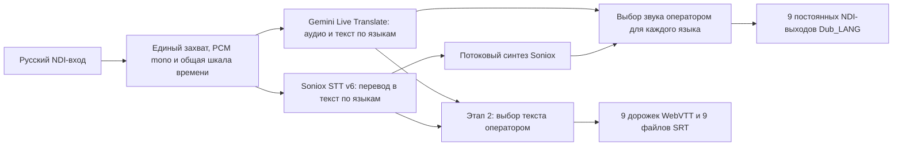

# Техническая спецификация (SPEC v2): PharmaLive Dubber

**Проект:** PharmaLive Dubber (Синхронный ИИ-переводчик прямого эфира 1 → 9 языков с визуальным контекстом слайдов)  
**Автор:** aqwarius2003  
**Дата обновления:** 24 ноября 2026 г.  
**Статус:** Утверждён к реализации (SPEC v2)

---

## 1. Обзор и архитектурные изменения (v1 → v2)

В ходе стресс-тестирования архитектуры (EGM Brainstorm & Review) были выявлены критические уязвимости исходной спецификации (v1):
1. **Единая точка отказа (SPOF) монолита Node B:** обработка 9 WebSocket-сессий в одном общем процессе приводила к падению всех 9 языковых каналов при малейшем сбое (утечка памяти, segfault в NDI/DSP C-библиотеках, блокировка event loop).
2. **Лимит сессий Gemini Live из-за JPEG-слайдов (P0-2):** передача изображений слайдов в мультимодальный WebSocket переводила сессию в класс «аудио+видео», принудительно ограничивая время жизни соединения ~2 минутами.
3. **Обрыв сессий и зазор при ротации (P0-1):** искусственный таймер на 12-й минуте с ожиданием паузы в речи (>300 мс) создавал риск неконтролируемого обрыва при непрерывной речи. Статистически при 9 сессиях с 20-секундным окном перезапуска вероятность того, что в любой момент времени хотя бы один язык находится в режиме тишины/фоллбэка, достигала ~26%.
4. **Неэффективность физического разделения на 9 машин:** идея установки 9 отдельных ноутбуков была детально проанализирована. Поскольку все машины находятся в одной локальной сети с общим интернет-шлюзом и единым источником NDI (vMix), физическое разделение не давало отказоустойчивости при сетевых авариях, но перегружало эфирный ПК (9 unicast NDI-подписок) и требовало 9 операторов.

### Рабочая схема

Сервер один раз принимает русский NDI-поток. Обе ветки перевода получают одинаковые аудиоблоки с номерами и временем исходной речи. В первом прогоне обе ветки активны. Выбор основного движка и режима готовности резерва производится по результатам этапа 1. На каждом языке действует один постоянный NDI-публикатор. Источник для него выбирает оператор.

### Будущий сервис на VPS

Для каждого эфира сервис выдаёт клиенту адрес для отправки исходного русского сигнала и отдельные адреса получения заказанных языков. Клиент подаёт исходную речь один раз и забирает нужные переводы в свою аппаратную. Возвращаемые голоса исключаются из исходного микса. Адреса и права на отправку и получение привязаны к сессии клиента. Ручной выбор Soniox или Gemini меняет звук внутри соответствующего языкового выхода и сохраняет его адрес.

В задаче 1А отделить приём сигнала и выдачу выбранного PCM от логики перевода. Локальный пилот сдаётся по NDI. Для первого испытания VPS предложен WebRTC через VDO.Ninja. На VPS запустить медиаклиент, принимающий русский поток и публикующий переведённый звук. Проверить RU → EN с возвратом в программу клиента, затем одновременный независимый приём EN и DE, далее — девяти языков. Лимит 3 с проверяется записью на стороне клиента от начала исходной фразы до слышимого соответствующего перевода после возврата по сети. Зафиксировать отдельно задержку перевода и доставки. SRT остаётся вариантом подключения по адресу для аппаратных, vMix Call требует отдельной проверки совместимости. Транспорт VPS выбирается после испытания.

## 2. Сквозной пайплайн обработки данных

## 3. Модульная спецификация программного обеспечения

### Модуль 1: NDI Ingest & Presentation Preprocessor (`ingest-hub`)
* **Единый захват NDI:** подписывается на поток `vMix_Feed` от Узла А.
* **Аудио-пайплайн:**
  * Захват 48 кГц Float32/Int16 PCM.
  * Ресемплинг библиотекой `libsoxr` в 16 кГц Int16 mono (чанки 20 мс / 640 байт).
  * Публикация чанков в сокет `ipc:///tmp/audio_translator/audio.ipc` по протоколу ZeroMQ PUB.
* **Видео-пайплайн (1 к/с):**
  * Забирает ровно 1 кадр в секунду. Если на входе чёрное поле (слайдов нет), хэш не меняется.
  * Расчёт хэша `imagehash.dhash`. При разнице $>5\%$ фиксируется смена слайда.
  * Локальный OCR-парсинг (заголовки, названия препаратов, коды испытаний).
  * Публикация JSON `{ "timestamp": float, "slide_text": str, "slide_id": int }` в `ipc:///tmp/audio_translator/slides.ipc`.

### Модуль 2. Две ветки перевода

* **Soniox.** Для каждого целевого языка передать общий поток в `stt-rt-v6` в режиме одностороннего перевода. Зафиксированный текст отдать в отдельный потоковый синтезатор с любым готовым голосом. Со второго этапа те же реплики доступны издателю субтитров независимо от синтезатора.
* **Gemini.** Открыть отдельную сессию `gemini-3.5-live-translate-preview` на каждый испытываемый язык с явным `target_language_code` и выходной транскрипцией. Для горячего резерва непрерывно передавать русский вход и принимать готовый звук. Восстановление соединения меняет статус готовности ветки. Право выбора эфирного источника остаётся у оператора. [Gemini Live Translate](https://ai.google.dev/gemini-api/docs/live-api/live-translate) · [Потоковый перевод и синтез Soniox](https://docs.soniox.com/translation/sts-translation)
* На выходе обеих веток привести звук к одному PCM-формату 48 кГц. Для каждого языка хранить короткие очереди и позицию воспроизведения, удалять просроченные фрагменты. Смысловые соответствия двух переводов проверять по контрольной записи: движки могут разбивать одну фразу по-разному.

### Модуль 3. Ручное переключение на резерв

Оператор может сам выбрать «В эфир Gemini» для указанного языка или подтвердить предложение системы. До явного действия оператора источник закреплён, даже если выбранная ветка замолчала. Возврат на Soniox также требует команды. При запоздалом восстановлении сервиса и после перезапуска сохранять последний выбор. Отклонённое или просроченное предложение ничего не меняет.

| Готовность Gemini | Что происходит после команды | Что измеряем |
|---|---|---|
| Горячий резерв: Gemini слышит весь доклад и уже выдаёт актуальный перевод | Локальный селектор подключает готовый звук внутри того же `Dub_<LANG>`. При сопоставимом положении двух переводов переключать на ближайшем аудиоблоке с коротким сглаживанием. | Проектный ориентир для немедленной команды при готовом звуке — до 0,5 с до слышимого перевода на контрольном NDI-приёмнике. Ждать ближайшей смысловой границы при плановом переходе можно дольше. |
| Запуск по команде | Установить соединение, передать начало ближайшего законченного по смыслу отрезка из короткого входного буфера вместе с продолжением речи и дождаться первого переведённого звука. Открытый сокет без истории речи также требует накопить контекст. | Записать отдельно установку сессии, ожидание достаточной речи, первый аудиоблок и вывод по NDI. На запуск могут уйти секунды. Верхняя граница 3 с для запуска требует проверки. |

Если резерв отстаёт, опережает основной перевод или ещё молчит, показать оператору положение обеих веток и статус «ожидание актуальной реплики». Предложить прослушивание резерва и переход на границе фразы. Немедленную команду выполнять только при наличии свежего звука. Неготовый резерв не получает эфир автоматически после восстановления: предложить новую команду. Краткое сглаживание устраняет щелчок, но смысловые повторы и пропуски при переходе оценивать отдельно.

### Модуль 4. Дашборд оператора

Для каждого языка показывать выбранный источник, свежесть текста и звука обоих движков, задержку и статус резерва. При разрыве соединения, остановке выдачи во время речи или расхождении дозировок в двух транскриптах выводить предупреждение. Расхождение — повод для прослушивания, точность перевода оценивает оператор. Дать ему предпрослушивание обеих веток и выбор источника по языку или явно выбранной группе. В журнал писать время обнаружения, подтверждения и первого слышимого звука нового источника. Время реакции человека учитывать отдельно.

### Модуль 5. Субтитры перевода

**Этап 2. Независимый источник текста.** Публиковать переведённые реплики с языком, идентификатором и временем на шкале программы. В ветке Soniox отключение озвучки оставляет работающим текстовый перевод. При полном отказе текстового перевода Soniox его новые реплики недоступны. Оператор может отдельно выбрать текст Gemini или явно переключить голос и текст вместе. Издание WebVTT/SRT использует тот же язык и временную шкалу при смене поставщика. На границе исключить повтор ранее опубликованной реплики.

**Для записи.** Из тех же реплик формировать девять файлов SubRip в UTF-8, например `session.en.srt` и `session.de.srt`. Каждый блок содержит номер, интервал показа относительно начала записи и текст. Зритель подключает файл нужного языка в плеере и может отключить субтитры. [Описание SubRip](https://www.loc.gov/preservation/digital/formats/fdd/fdd000569.shtml)

**Для прямого эфира.** Предлагаемый формат — отдельные языковые дорожки WebVTT для HLS-совместимого плеера. Публиковать обновляемые плейлисты с сегментами WebVTT. В основном плейлисте программы объявить группу `SUBTITLES` с кодами языков и привязать её к варианту воспроизведения. Плеер показывает выбор языка и пункт выключения. Проект отдаёт дорожки по локальной сети параллельно девяти NDI-голосам. Приёмной стороне нужна поддержка этих дорожек или адаптер к её формату. [WebVTT в HLS](https://datatracker.ietf.org/doc/html/rfc8216#section-3.5) · [Объявление дорожек](https://datatracker.ietf.org/doc/html/rfc8216#section-4.3.4.1)

**Синхронизация.** Архивный SRT использует время исходных реплик с поправкой на начало записи. Для прямого эфира сопоставить эту шкалу со временем медиапрограммы и задать запас на появление перевода до публикации соответствующего сегмента. Показ и закрытие реплики управляются часами программы даже при выключенном голосе. При запаздывании текста измерить фактический момент показа и отдельно учесть вклад буфера принимающего плеера.

---

## 4. Требования к аппаратному обеспечению и сети

| Компонент | Минимальные требования | Роль в системе |
|---|---|---|
| **Эфирный ПК (Узел А)** | Текущая рабочая станция vMix (Windows 10/11) | Формирование 1 NDI потока (1 к/с + аудио), приём 9 NDI аудиопотоков, раздача в эфир |
| **Сервер-переводчик (Узел Б)** | CPU: 8 ядер (Intel Core i7 10+ пок. / AMD Ryzen 7) RAM: 16–32 ГБ ОС: Ubuntu 22.04 LTS / Debian 12 | Запуск Docker Compose: 1 ingest-hub + 9 worker контейнеров + dashboard |
| **Локальная сеть** | Проводной 1 Gbps Ethernet коммутатор (без Wi-Fi) | Общий трафик: ~15–20 Мбит/с на приём + ~30 Мбит/с на отдачу 9 аудио NDI |
| **Интернет-канал** | От 20–30 Мбит/с симметричный с резервированием (LTE/4G failover роутер) | При полном горячем резерве измерить одновременный трафик обеих веток и квоты на девять языков |

---

## 5. План поэтапного внедрения и валидации (Roadmap)

### Этап 1. Общий NDI-вход, параллельный перевод Gemini и Soniox, ручной резерв

1. **Сравнить на одном сигнале.** Подать размеченную запись русского фармацевтического доклада в темпе эфира через одну NDI-подписку на оба движка. Начать с RU → EN и RU → DE, затем запустить девять целевых языков одновременно. Для сравнения записать обе ветки. В эфире для каждого языка публиковать один выбранный звук.
2. **Выбрать основной движок.** На одних и тех же репликах сравнить полноту смысла, точность терминов, отрицаний, чисел и единиц. Зафиксировать p50, p95, максимум и долю превышений 3 с от русского NDI-входа до соответствующего перевода на NDI-приёмнике. Сравнить текст для будущих субтитров и реальные расходы на час «голос + текст» на одном и девяти языках, отдельно — стоимость текста при выключенной озвучке и добавочную стоимость горячего Gemini. Если качество сопоставимо, целевая задержка выдержана и конфигурация Soniox даёт экономию с учётом выбранного режима резерва, назначить Soniox основным, Gemini — резервным. В остальных случаях зафиксировать результаты для решения оператора проекта.
3. **Измерить ручной переход.** Во время длинной реплики, на паузе и после имитации отказа Soniox испытать горячий резерв и запуск Gemini по команде. Проверить прямую команду, подтверждение предупреждения, отказ от предложения и ручной возврат. Без команды маршрут должен сохраняться. Записать время «команда → первое слышимое слово Gemini», пропуски и повторы. Паузы докладчика отметить отдельно. Цель до 3 с для обычного перевода и время выполнения команды — две разные метрики.
4. **Длительный прогон.** Проверить один язык на четырёхчасовой записи, затем провести двухчасовую репетицию всех девяти каналов с выводом `Dub_<LANG>`. Зафиксировать периоды, когда резерв готов, и итоговый расход обеих веток.

### Этап 2. Живые субтитры на девяти языках

#### 2.1. Сравнительные испытания DeepL Aure и Soniox STT v6

Цель — выбрать движок для озвучки и независимых субтитров. Использовать записи и биллинг Soniox и Gemini из этапа 1. Добавить DeepL Aure на том же материале и проверить возможности субтитров в сопоставимых условиях. Для всех трёх вариантов воспроизвести через один русский NDI-вход одну и ту же размеченную запись фармацевтического доклада в темпе эфира. Использовать готовые голоса. Начать с RU → EN и RU → DE, затем проверить все девять целевых языков одновременно. До прогона зафиксировать список языков, версию модели, регион API, тариф и доступное число одновременных каналов.

| Вариант | Что испытываем |
|---|---|
| **DeepL Aure** | Проверить доступ к Aure через DeepL Voice для используемого аккаунта, возможность подать русский звук и получить поток переведённого аудио и текста для выбранных языков. Если конфигурация доступна только в демо или версия модели не подтверждена, отметить это в отчёте. Сквозной замер требует вывода полученного аудио в NDI. [Описание Aure](https://www.deepl.com/en/press-release/aure-voice-ai-model) |
| **Soniox STT v6 + потоковый синтез Soniox** | Использовать модель реального времени `stt-rt-v6`. Направлять переведённые фрагменты в модуль субтитров и отдельно в синтезатор. Измерять задержку вплоть до звучащего NDI-выхода. В стоимость включать и перевод, и синтез. [Модель STT v6](https://docs.soniox.com/stt/models) · [Схема потоковой озвучки](https://docs.soniox.com/translation/sts-translation) |

По итогам заполнить таблицу результатов для каждого движка и языка:

1. **Задержка.** От начала размеченного смыслового фрагмента на русском NDI-входе измерить время до первого соответствующего слова на NDI-выходе и отдельно до видимых субтитров. Указать p50, p95, максимум, долю превышений порога 3 с и число пропусков.
2. **Точность.** Сверить звук и субтитры с эталоном по названиям препаратов, отрицаниям, числам и единицам. Для каждого искажения дозировки или смысла сохранить исходную фразу и перевод.
3. **Субтитры при отключении голоса.** Посреди доклада остановить озвучку одного языка. Проверить, что последующие реплики видны в переключаемой дорожке WebVTT и попадают в файл SRT. Отдельно отметить, продолжает ли поставщик тарифицировать синтез.
4. **Стоимость.** По данным биллинга привести USD за час входной программы с одним языком и с девятью одновременными языками. Для короткого прогона указать его длительность и пометить пересчёт на час как оценку.

Результат этапа — решение о выборе движка с указанием языкового покрытия, превышений 3 с, критических смысловых ошибок, поведения субтитров и стоимости. Gemini остаётся допустимым выбором. Для недоступной конфигурации записать причину и оставить её показатели незаполненными.

#### 2.2. Приёмка субтитров выбранного движка

1. В совместимом плеере включить и выключить дорожку, сменить язык и проверить все девять вариантов. После прогона открыть соответствующие `.srt` с записью и сверить временные метки, в том числе после длинной паузы.
2. Во время непрерывной русской речи отключить озвучку одного языка, затем остановить его процесс синтеза. Новые реплики этого языка должны по-прежнему появляться на экране и записываться в SRT. После возврата озвучки проверить текущую фразу и отсутствие повторной выдачи пропущенного звука. Повторить с отключением всех голосов.
3. Записать время от начала исходного фрагмента до видимого текста при работающем и выключенном голосе. Отметить пропуски, повторы и превышения 3 с. При включённом голосе отдельно проверить исходный критерий задержки до NDI и рассинхрон текста с озвучкой.

### Этап 3. Сменные голоса

Подключить выбор голоса по языку, включая заранее обученный голос владельца. Начать с одного канала. После смены профиля сверить звучащую реплику с субтитрами того же языка и повторить замер задержки с новым синтезатором.
