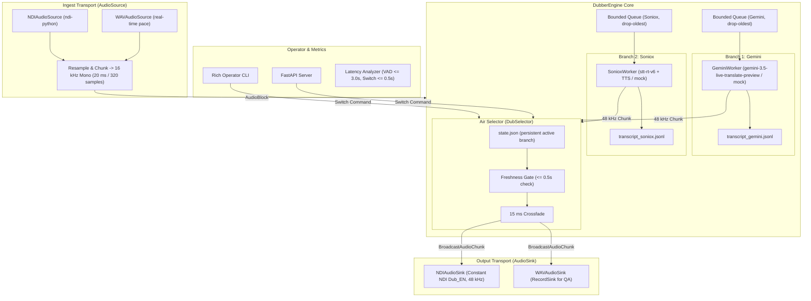

# PharmaLive Dubber — Task 1A Implementation Plan

> **For agentic workers:** REQUIRED SUB-SKILL: Use superpowers:subagent-driven-development to implement this plan task-by-task. Steps use checkbox (`- [ ]`) syntax for tracking.

**Goal:** Build and verify Task 1A for PharmaLive Dubber: a resilient real-time RU → EN dubbing pipeline with decoupled AudioSource/AudioSink, dual translation branches (Gemini Live Translate and Soniox STT v6 + TTS), zero-auto-switching DubSelector with freshness gating, constant `Dub_EN` NDI publisher at 48 kHz, Rich operator CLI, and automated latency measurement under 3.0 s.

**Architecture:** An I/O-decoupled streaming architecture where `AudioSource` (NDI / WAV) standardizes Russian input to 16 kHz mono 20 ms `AudioBlock` chunks. `DubberEngine` concurrently distributes blocks to Gemini and Soniox branches via bounded queues (`maxsize=100`, drop-oldest). `DubSelector` routes the operator-selected branch to `AudioSink` (NDI `Dub_EN` 48 kHz / WAV) with a 0.5 s freshness gate, persistent state in `state.json`, and 15 ms crossfade.

**Architecture Diagram:**



**Tech Stack:** Python 3.11+, `uv`, `ndi-python`, `google-genai`, `websockets`, `scipy`, `numpy`, `rich`, `fastapi`, `uvicorn`, `pytest`, `pytest-asyncio`.

**Spec Reference:** [docs/superpowers/specs/2026-11-24-task-1a-design.md](file:///d:/audio_translator/docs/superpowers/specs/2026-11-24-task-1a-design.md)

---

## Global Constraints

- **Dependency management:** Strictly use `uv` (`uv run`, `uv add`, `uv pip`).
- **Transport decoupling:** `AudioSource` and `AudioSink` must be decoupled from the core translator and selector. No NDI/network calls inside workers or selector.
- **Single ingest capture:** One capture feeds both branches with identical numbered and timestamped `AudioBlock` items.
- **Worker independence:** A slow, paused, or failing branch must never block the audio capture or the sibling branch (bounded queue `maxsize=100` with drop-oldest policy).
- **Constant NDI output:** Exactly one constant NDI publisher named `Dub_EN` running at 48 kHz PCM16.
- **Zero auto-switching:** Routing to air is switched strictly by direct operator command; provider failures output silence and raise alerts, never auto-fallback.
- **Freshness gate:** Rejects switch commands if the target branch's last audio is older than 0.5 s or branch is not `READY`.
- **Persistent routing:** The active branch selection must persist in `state.json` across selector restarts.
- **Acoustic smoothing:** 15 ms crossfade (720 samples at 48 kHz) applied when switching active air channels to prevent audio clicks.
- **Latency target:** End-to-end latency from Russian speech start to first heard English audio $\le 3.0$ s. Switch response $\le 0.5$ s.
- **Scope limitation:** ElevenLabs is excluded from Task 1A.

---

## Implementation Tasks

### Task 1: Project Scaffolding & Configuration

**Files:**
- Create: `pyproject.toml`
- Create: `.gitignore`
- Create: `.env.example`
- Create: `dubber/__init__.py`
- Create: `dubber/config.py`
- Test: `tests/__init__.py`
- Test: `tests/test_config.py`

**Interfaces:**
- Consumes: Environment variables (`GEMINI_API_KEY`, `SONIOX_API_KEY`, `NDI_SOURCE_NAME`, etc.)
- Produces: `DubberConfig` class with typed fields (`source_type`, `provider_mode`, `ndi_source_name`, `ndi_sink_name`, `sample_rate_in`, `sample_rate_out`, `gemini_api_key`, `soniox_api_key`)

- [ ] **Step 1: Write the failing test for configuration**

```python
# tests/test_config.py
import os
import pytest
from dubber.config import DubberConfig

def test_default_config():
    config = DubberConfig()
    assert config.source_type == "wav"
    assert config.provider_mode == "mock"
    assert config.ndi_sink_name == "Dub_EN"
    assert config.sample_rate_in == 16000
    assert config.sample_rate_out == 48000
    assert config.max_queue_size == 100
    assert config.freshness_threshold_s == 0.5
    assert config.crossfade_ms == 15

def test_config_from_env(monkeypatch):
    monkeypatch.setenv("DUBBER_SOURCE_TYPE", "ndi")
    monkeypatch.setenv("DUBBER_PROVIDER_MODE", "live")
    monkeypatch.setenv("GEMINI_API_KEY", "test_gemini_key")
    monkeypatch.setenv("SONIOX_API_KEY", "test_soniox_key")
    monkeypatch.setenv("DUBBER_NDI_SOURCE_NAME", "vMix_Feed")
    
    config = DubberConfig.from_env()
    assert config.source_type == "ndi"
    assert config.provider_mode == "live"
    assert config.gemini_api_key == "test_gemini_key"
    assert config.soniox_api_key == "test_soniox_key"
    assert config.ndi_source_name == "vMix_Feed"
```

- [ ] **Step 2: Run test to verify it fails**

Run: `uv run pytest tests/test_config.py -v`
Expected: FAIL with `ModuleNotFoundError: No module named 'dubber'`

- [ ] **Step 3: Create pyproject.toml, .gitignore, .env.example, and dubber/config.py**

```toml
# pyproject.toml
[project]
name = "pharmalive-dubber"
version = "0.1.0"
description = "PharmaLive Dubber: Real-time dual-branch RU->EN simultaneous dubbing system"
readme = "README.md"
requires-python = ">=3.11"
dependencies = [
    "ndi-python>=6.3.0",
    "google-genai>=3.0.0",
    "websockets>=13.0",
    "scipy>=1.14.0",
    "numpy>=2.0.0",
    "rich>=13.0.0",
    "fastapi>=0.115.0",
    "uvicorn>=0.30.0",
    "pydantic>=2.8.0",
    "python-dotenv>=1.0.0",
]

[project.optional-dependencies]
dev = [
    "pytest>=8.0.0",
    "pytest-asyncio>=0.24.0",
]

[project.scripts]
dubber = "dubber.cli:main"

[build-system]
requires = ["hatchling"]
build-backend = "hatchling.build"
```

```gitignore
# .gitignore
__pycache__/
*.pyc
*.pyo
.venv/
.env
logs/*.jsonl
logs/*.log
state.json
dist/
build/
*.egg-info/
.pytest_cache/
output/
```

```env
# .env.example
DUBBER_SOURCE_TYPE=wav
DUBBER_PROVIDER_MODE=mock
DUBBER_WAV_FILE=data/test_speech_ru.wav
DUBBER_NDI_SOURCE_NAME=
DUBBER_NDI_SINK_NAME=Dub_EN
GEMINI_API_KEY=
SONIOX_API_KEY=
```

```python
# dubber/__init__.py
"""PharmaLive Dubber package."""
__version__ = "0.1.0"
```

```python
# dubber/config.py
import os
from dataclasses import dataclass
from typing import Literal, Optional
from dotenv import load_dotenv

load_dotenv()

@dataclass
class DubberConfig:
    source_type: Literal["wav", "ndi"] = "wav"
    provider_mode: Literal["mock", "live"] = "mock"
    wav_file_path: Optional[str] = "data/test_speech_ru.wav"
    ndi_source_name: Optional[str] = None
    ndi_sink_name: str = "Dub_EN"
    sample_rate_in: int = 16000
    sample_rate_out: int = 48000
    block_duration_ms: int = 20
    max_queue_size: int = 100
    freshness_threshold_s: float = 0.5
    crossfade_ms: int = 15
    gemini_api_key: Optional[str] = None
    soniox_api_key: Optional[str] = None
    state_file_path: str = "state.json"
    http_port: int = 8000
    http_host: str = "127.0.0.1"

    @classmethod
    def from_env(cls) -> "DubberConfig":
        return cls(
            source_type=os.getenv("DUBBER_SOURCE_TYPE", "wav"),  # type: ignore
            provider_mode=os.getenv("DUBBER_PROVIDER_MODE", "mock"),  # type: ignore
            wav_file_path=os.getenv("DUBBER_WAV_FILE", "data/test_speech_ru.wav"),
            ndi_source_name=os.getenv("DUBBER_NDI_SOURCE_NAME"),
            ndi_sink_name=os.getenv("DUBBER_NDI_SINK_NAME", "Dub_EN"),
            gemini_api_key=os.getenv("GEMINI_API_KEY"),
            soniox_api_key=os.getenv("SONIOX_API_KEY"),
            state_file_path=os.getenv("DUBBER_STATE_FILE", "state.json"),
            http_port=int(os.getenv("DUBBER_HTTP_PORT", "8000")),
            http_host=os.getenv("DUBBER_HTTP_HOST", "127.0.0.1"),
        )
```

- [ ] **Step 4: Run test to verify it passes**

Run: `uv run pytest tests/test_config.py -v`
Expected: PASS

- [ ] **Step 5: Commit changes**

```bash
git add pyproject.toml .gitignore .env.example dubber/__init__.py dubber/config.py tests/__init__.py tests/test_config.py
git commit -m "feat(scaffold): initialize pyproject, config and env loading"
```

---

### Task 2: Core Data Types & Synchronization Models

**Files:**
- Create: `dubber/types.py`
- Test: `tests/test_audio_block.py`

**Interfaces:**
- Produces:
  - `AudioBlock(session_id: str, block_index: int, sample_offset: int, source_time: float, pcm_data: bytes)`
  - `BroadcastAudioChunk(session_id: str, language: str, source_branch: str, block_index: int, source_time: float, sample_rate: int, channels: int, pcm_data: bytes)`
  - `BranchType = Literal["gemini", "soniox"]`
  - `BranchStatus = Literal["STARTING", "READY", "RUNNING", "STALE", "ERROR", "STOPPED"]`
  - `BranchState(branch: BranchType, status: BranchStatus, last_audio_time: float, latency_s: float, last_transcript: str, error_message: Optional[str])`

- [ ] **Step 1: Write the failing tests for types and constraints**

```python
# tests/test_audio_block.py
import pytest
from dubber.types import AudioBlock, BroadcastAudioChunk, BranchState

def test_audio_block_creation_and_immutability():
    pcm_bytes = b"\x00\x00" * 320  # 320 samples of 16-bit PCM = 640 bytes (20 ms at 16 kHz)
    block = AudioBlock(
        session_id="test_session",
        block_index=0,
        sample_offset=0,
        source_time=100.0,
        pcm_data=pcm_bytes
    )
    assert block.block_index == 0
    assert len(block.pcm_data) == 640
    assert block.duration_ms == 20.0
    
    with pytest.raises(Exception):
        block.block_index = 1  # immutable (frozen)

def test_broadcast_chunk_properties():
    # 48 kHz mono 20 ms chunk = 960 samples = 1920 bytes
    pcm_48k = b"\x00\x00" * 960
    chunk = BroadcastAudioChunk(
        session_id="test_session",
        language="en",
        source_branch="gemini",
        block_index=42,
        source_time=102.5,
        sample_rate=48000,
        channels=1,
        pcm_data=pcm_48k
    )
    assert chunk.sample_rate == 48000
    assert chunk.duration_ms == 20.0
    assert chunk.source_branch == "gemini"

def test_branch_state_freshness():
    state = BranchState(
        branch="soniox",
        status="READY",
        last_audio_time=100.0,
        latency_s=1.2,
        last_transcript="Hello world"
    )
    assert state.is_fresh(current_time=100.3, max_age_s=0.5) is True
    assert state.is_fresh(current_time=100.6, max_age_s=0.5) is False
```

- [ ] **Step 2: Run test to verify it fails**

Run: `uv run pytest tests/test_audio_block.py -v`
Expected: FAIL with `ModuleNotFoundError: No module named 'dubber.types'`

- [ ] **Step 3: Implement dubber/types.py**

```python
# dubber/types.py
from dataclasses import dataclass, field
from typing import Literal, Optional

BranchType = Literal["gemini", "soniox"]
BranchStatus = Literal["STARTING", "READY", "RUNNING", "STALE", "ERROR", "STOPPED"]

@dataclass(frozen=True)
class AudioBlock:
    session_id: str
    block_index: int
    sample_offset: int
    source_time: float
    pcm_data: bytes

    @property
    def duration_ms(self) -> float:
        # Assuming 16 kHz 16-bit mono: 2 bytes per sample -> 32 bytes per ms
        return (len(self.pcm_data) / 2) / 16.0

@dataclass(frozen=True)
class BroadcastAudioChunk:
    session_id: str
    language: str
    source_branch: str
    block_index: int
    source_time: float
    sample_rate: int = 48000
    channels: int = 1
    pcm_data: bytes = b""

    @property
    def duration_ms(self) -> float:
        bytes_per_sample = 2 * self.channels
        samples = len(self.pcm_data) / bytes_per_sample
        return (samples / self.sample_rate) * 1000.0

@dataclass
class BranchState:
    branch: BranchType
    status: BranchStatus = "STARTING"
    last_audio_time: float = 0.0
    latency_s: float = 0.0
    last_transcript: str = ""
    error_message: Optional[str] = None
    dropped_blocks_count: int = 0

    def is_fresh(self, current_time: float, max_age_s: float = 0.5) -> bool:
        if self.status != "READY" and self.status != "RUNNING":
            return False
        return (current_time - self.last_audio_time) <= max_age_s
```

- [ ] **Step 4: Run test to verify it passes**

Run: `uv run pytest tests/test_audio_block.py -v`
Expected: PASS

- [ ] **Step 5: Commit changes**

```bash
git add dubber/types.py tests/test_audio_block.py
git commit -m "feat(types): define AudioBlock, BroadcastAudioChunk, and BranchState"
```

---

### Task 3: Ingest Layer — AudioSource ABC & WAVAudioSource

**Files:**
- Create: `dubber/ingest/base.py`
- Create: `dubber/ingest/wav_source.py`
- Test: `tests/test_wav_ingest.py`

**Interfaces:**
- Consumes: WAV file path, `DubberConfig`
- Produces: `AudioSource` abstract class, `WAVAudioSource` generating 16 kHz mono 20 ms `AudioBlock` items paced in real time.

- [ ] **Step 1: Write the failing tests for WAVAudioSource**

```python
# tests/test_wav_ingest.py
import pytest
import io
import wave
import numpy as np
import asyncio
from dubber.ingest.wav_source import WAVAudioSource
from dubber.types import AudioBlock

def create_synthetic_wav(duration_s=0.2, sample_rate=44100, channels=2) -> bytes:
    buf = io.BytesIO()
    num_samples = int(duration_s * sample_rate)
    # Generate 440 Hz tone
    t = np.linspace(0, duration_s, num_samples, endpoint=False)
    audio_data = (0.5 * np.sin(2 * np.pi * 440 * t) * 32767).astype(np.int16)
    
    if channels == 2:
        audio_data = np.column_stack((audio_data, audio_data)).flatten()
        
    with wave.open(buf, "wb") as wf:
        wf.setnchannels(channels)
        wf.setsampwidth(2)
        wf.setframerate(sample_rate)
        wf.writeframes(audio_data.tobytes())
    return buf.getvalue()

@pytest.mark.asyncio
async def test_wav_audio_source_resampling_and_chunking(tmp_path):
    wav_path = tmp_path / "test.wav"
    wav_path.write_bytes(create_synthetic_wav(duration_s=0.1, sample_rate=48000, channels=1))
    
    source = WAVAudioSource(file_path=str(wav_path), session_id="sess_1", real_time_pace=False)
    await source.start()
    
    blocks = []
    try:
        while True:
            block = await source.read_block()
            if block is None:
                break
            blocks.append(block)
    finally:
        await source.stop()
        
    # 0.1s at 16 kHz = 1600 samples. At 320 samples per block (20ms), that is 5 blocks.
    assert len(blocks) == 5
    for i, blk in enumerate(blocks):
        assert isinstance(blk, AudioBlock)
        assert blk.block_index == i
        assert len(blk.pcm_data) == 640  # 320 samples * 2 bytes
        assert blk.session_id == "sess_1"
```

- [ ] **Step 2: Run test to verify it fails**

Run: `uv run pytest tests/test_wav_ingest.py -v`
Expected: FAIL with `ModuleNotFoundError: No module named 'dubber.ingest'`

- [ ] **Step 3: Implement dubber/ingest/base.py and dubber/ingest/wav_source.py**

```python
# dubber/ingest/base.py
from abc import ABC, abstractmethod
from typing import Optional
from dubber.types import AudioBlock

class AudioSource(ABC):
    @abstractmethod
    async def start(self) -> None:
        """Initialize and start capturing/reading audio."""
        ...

    @abstractmethod
    async def stop(self) -> None:
        """Stop capturing and release resources."""
        ...

    @abstractmethod
    async def read_block(self) -> Optional[AudioBlock]:
        """Read the next 20 ms AudioBlock. Returns None when EOF or stopped."""
        ...
```

```python
# dubber/ingest/wav_source.py
import asyncio
import time
import wave
import numpy as np
from scipy.signal import resample_poly
from typing import Optional
from dubber.ingest.base import AudioSource
from dubber.types import AudioBlock

class WAVAudioSource(AudioSource):
    def __init__(self, file_path: str, session_id: str = "wav_session", real_time_pace: bool = True):
        self.file_path = file_path
        self.session_id = session_id
        self.real_time_pace = real_time_pace
        self._block_index = 0
        self._sample_offset = 0
        self._audio_data_16k: np.ndarray = np.array([], dtype=np.int16)
        self._current_pos = 0
        self._start_time: float = 0.0
        self._running = False
        self._block_samples = 320  # 20 ms at 16 kHz

    async def start(self) -> None:
        with wave.open(self.file_path, "rb") as wf:
            channels = wf.getnchannels()
            sample_width = wf.getsampwidth()
            orig_sr = wf.getframerate()
            frames = wf.readframes(wf.getnframes())

        if sample_width != 2:
            raise ValueError(f"Only 16-bit PCM WAV is supported, got sample width {sample_width}")

        raw_samples = np.frombuffer(frames, dtype=np.int16)
        if channels > 1:
            raw_samples = raw_samples.reshape(-1, channels)
            raw_samples = np.mean(raw_samples, axis=1).astype(np.int16)

        if orig_sr != 16000:
            # Resample to 16000 Hz using rational fraction resample_poly
            from math import gcd
            g = gcd(orig_sr, 16000)
            up = 16000 // g
            down = orig_sr // g
            resampled = resample_poly(raw_samples.astype(np.float32), up, down)
            self._audio_data_16k = np.clip(resampled, -32768, 32767).astype(np.int16)
        else:
            self._audio_data_16k = raw_samples

        self._current_pos = 0
        self._block_index = 0
        self._sample_offset = 0
        self._running = True
        self._start_time = time.monotonic()

    async def stop(self) -> None:
        self._running = False

    async def read_block(self) -> Optional[AudioBlock]:
        if not self._running:
            return None

        if self._current_pos + self._block_samples > len(self._audio_data_16k):
            # EOF
            self._running = False
            return None

        # Real-time pacing with drift compensation
        if self.real_time_pace:
            expected_time = self._start_time + (self._sample_offset / 16000.0)
            now = time.monotonic()
            wait_time = expected_time - now
            if wait_time > 0.001:
                await asyncio.sleep(wait_time)

        chunk = self._audio_data_16k[self._current_pos : self._current_pos + self._block_samples]
        block = AudioBlock(
            session_id=self.session_id,
            block_index=self._block_index,
            sample_offset=self._sample_offset,
            source_time=time.monotonic(),
            pcm_data=chunk.tobytes(),
        )

        self._current_pos += self._block_samples
        self._sample_offset += self._block_samples
        self._block_index += 1
        return block
```

- [ ] **Step 4: Run test to verify it passes**

Run: `uv run pytest tests/test_wav_ingest.py -v`
Expected: PASS

- [ ] **Step 5: Commit changes**

```bash
git add dubber/ingest/base.py dubber/ingest/wav_source.py tests/test_wav_ingest.py
git commit -m "feat(ingest): add AudioSource ABC and WAVAudioSource with real-time chunking"
```

---

### Task 4: Ingest Layer — NDIAudioSource

**Files:**
- Create: `dubber/ingest/ndi_source.py`
- Test: `tests/test_ndi_source.py`

**Interfaces:**
- Consumes: NDI source name pattern or first available NDI source, `ndi-python`
- Produces: `NDIAudioSource` capturing frames, converting Float32/Int16 to 16 kHz Mono PCM16, generating 20 ms `AudioBlock` items.

- [ ] **Step 1: Write unit tests with mock NDI library**

```python
# tests/test_ndi_source.py
import pytest
import numpy as np
import asyncio
from unittest.mock import MagicMock, patch
from dubber.ingest.ndi_source import NDIAudioSource
from dubber.types import AudioBlock

@pytest.mark.asyncio
async def test_ndi_audio_source_conversion():
    with patch("dubber.ingest.ndi_source.ndi") as mock_ndi:
        mock_ndi.initialize.return_value = True
        mock_recv = MagicMock()
        mock_ndi.recv_create_v3.return_value = mock_recv
        
        # Mock frame capturing: 48 kHz stereo float32 frame of 960 samples (20 ms)
        audio_frame = MagicMock()
        audio_frame.sample_rate = 48000
        audio_frame.no_channels = 2
        audio_frame.no_samples = 960
        
        # Float32 stereo audio in [-1.0, 1.0]
        data = np.zeros((960, 2), dtype=np.float32)
        audio_frame.data = data
        
        call_count = 0
        def capture_side_effect(recv, a_frame, v_frame, m_frame, timeout_ms):
            nonlocal call_count
            if call_count < 2:
                call_count += 1
                return mock_ndi.FRAME_TYPE_AUDIO
            return mock_ndi.FRAME_TYPE_NONE

        mock_ndi.recv_capture_v3.side_effect = capture_side_effect
        mock_ndi.FRAME_TYPE_AUDIO = 2
        mock_ndi.FRAME_TYPE_NONE = 0

        source = NDIAudioSource(source_name="TEST_SRC", session_id="ndi_test")
        await source.start()
        
        block = await source.read_block()
        assert block is not None
        assert isinstance(block, AudioBlock)
        assert len(block.pcm_data) == 640  # 320 samples * 2 bytes
        
        await source.stop()
```

- [ ] **Step 2: Run test to verify it fails**

Run: `uv run pytest tests/test_ndi_source.py -v`
Expected: FAIL with `ModuleNotFoundError: No module named 'dubber.ingest.ndi_source'`

- [ ] **Step 3: Implement dubber/ingest/ndi_source.py**

```python
# dubber/ingest/ndi_source.py
import asyncio
import logging
import time
import numpy as np
from typing import Optional
from scipy.signal import resample_poly
from math import gcd

try:
    import NDIlib as ndi
except ImportError:
    ndi = None

from dubber.ingest.base import AudioSource
from dubber.types import AudioBlock

logger = logging.getLogger(__name__)

class NDIAudioSource(AudioSource):
    def __init__(self, source_name: Optional[str] = None, session_id: str = "ndi_session"):
        self.source_name = source_name
        self.session_id = session_id
        self._recv = None
        self._running = False
        self._block_index = 0
        self._sample_offset = 0
        self._pcm_buffer = bytearray()
        self._block_bytes = 640  # 320 samples * 2 bytes (20 ms at 16 kHz)

    async def start(self) -> None:
        if ndi is None:
            raise RuntimeError("NDIlib is not installed. Install ndi-python to use NDIAudioSource.")
        if not ndi.initialize():
            raise RuntimeError("Failed to initialize NDIlib.")

        find = ndi.find_create_v2()
        if not find:
            raise RuntimeError("Failed to create NDI find instance.")

        target_source = None
        # Search for source if name given, or take first available
        for _ in range(20):
            ndi.find_wait_for_sources(find, 100)
            sources = ndi.find_get_current_sources(find)
            if sources:
                if self.source_name:
                    for s in sources:
                        if self.source_name.lower() in s.ndi_name.lower():
                            target_source = s
                            break
                else:
                    target_source = sources[0]
                if target_source:
                    break
        ndi.find_destroy(find)

        if not target_source:
            raise RuntimeError(f"NDI source '{self.source_name or 'any'}' not found on the network.")

        recv_create = ndi.RecvCreateV3()
        recv_create.source_to_connect_to = target_source
        recv_create.color_format = ndi.RECV_COLOR_FORMAT_BGRX_BGRA
        recv_create.bandwidth = ndi.RECV_BANDWIDTH_AUDIO_ONLY
        self._recv = ndi.recv_create_v3(recv_create)
        if not self._recv:
            raise RuntimeError(f"Failed to connect to NDI source: {target_source.ndi_name}")

        self._running = True
        logger.info(f"Connected NDIAudioSource to '{target_source.ndi_name}'")

    async def stop(self) -> None:
        self._running = False
        if self._recv and ndi:
            ndi.recv_destroy(self._recv)
            self._recv = None
            ndi.destroy()

    async def read_block(self) -> Optional[AudioBlock]:
        if not self._running or not self._recv:
            return None

        # Return from buffer if we already have >= 640 bytes
        while len(self._pcm_buffer) < self._block_bytes and self._running:
            # Capture frame in thread executor to not block asyncio event loop
            loop = asyncio.get_running_loop()
            audio_frame = await loop.run_in_executor(None, self._capture_frame)
            if audio_frame is None:
                await asyncio.sleep(0.005)
                continue

            # Convert to 16 kHz mono PCM16
            pcm_chunk = self._process_frame_to_pcm16_16k(audio_frame)
            self._pcm_buffer.extend(pcm_chunk)

        if len(self._pcm_buffer) >= self._block_bytes:
            data = bytes(self._pcm_buffer[: self._block_bytes])
            del self._pcm_buffer[: self._block_bytes]

            block = AudioBlock(
                session_id=self.session_id,
                block_index=self._block_index,
                sample_offset=self._sample_offset,
                source_time=time.monotonic(),
                pcm_data=data,
            )
            self._block_index += 1
            self._sample_offset += 320
            return block

        return None

    def _capture_frame(self):
        audio_frame = ndi.AudioFrameV3()
        frame_type = ndi.recv_capture_v3(self._recv, None, audio_frame, None, 50)
        if frame_type == ndi.FRAME_TYPE_AUDIO:
            return audio_frame
        return None

    def _process_frame_to_pcm16_16k(self, frame) -> bytes:
        data = frame.data
        if data is None or frame.no_samples == 0:
            return b""

        # Normalize channels to mono
        if frame.no_channels > 1:
            data = np.mean(data, axis=1)

        # Convert float32 [-1.0, 1.0] to int16
        if data.dtype == np.float32:
            data = (np.clip(data, -1.0, 1.0) * 32767).astype(np.int16)

        # Resample to 16 kHz if necessary
        orig_sr = frame.sample_rate
        if orig_sr != 16000 and len(data) > 0:
            g = gcd(orig_sr, 16000)
            up = 16000 // g
            down = orig_sr // g
            resampled = resample_poly(data.astype(np.float32), up, down)
            data = np.clip(resampled, -32768, 32767).astype(np.int16)

        return data.tobytes()
```

- [ ] **Step 4: Run test to verify it passes**

Run: `uv run pytest tests/test_ndi_source.py -v`
Expected: PASS

- [ ] **Step 5: Commit changes**

```bash
git add dubber/ingest/ndi_source.py tests/test_ndi_source.py
git commit -m "feat(ingest): add NDIAudioSource with async NDI capture and 16 kHz conversion"
```

---

### Task 5: Sink Layer — AudioSink Interface, WAVAudioSink & NDIAudioSink

**Files:**
- Create: `dubber/sink/base.py`
- Create: `dubber/sink/wav_sink.py`
- Create: `dubber/sink/ndi_sink.py`
- Test: `tests/test_sink.py`

**Interfaces:**
- Consumes: `BroadcastAudioChunk`
- Produces: `AudioSink` ABC, `WAVAudioSink` for recording/verifying 48 kHz output, and `NDIAudioSink` maintaining a constant `Dub_EN` NDI sender with silence filling on idle.

- [ ] **Step 1: Write unit tests for WAVAudioSink and NDIAudioSink**

```python
# tests/test_sink.py
import pytest
import wave
import numpy as np
from unittest.mock import MagicMock, patch
from dubber.sink.wav_sink import WAVAudioSink
from dubber.sink.ndi_sink import NDIAudioSink
from dubber.types import BroadcastAudioChunk

@pytest.mark.asyncio
async def test_wav_audio_sink(tmp_path):
    out_wav = tmp_path / "output.wav"
    sink = WAVAudioSink(file_path=str(out_wav), sample_rate=48000, channels=1)
    await sink.start()
    
    # Send two 20 ms 48 kHz chunks (960 samples * 2 = 1920 bytes each)
    pcm_data = (np.ones(960, dtype=np.int16) * 1000).tobytes()
    chunk1 = BroadcastAudioChunk("sess_1", "en", "gemini", 0, 100.0, 48000, 1, pcm_data)
    chunk2 = BroadcastAudioChunk("sess_1", "en", "gemini", 1, 100.02, 48000, 1, pcm_data)
    
    await sink.write_chunk(chunk1)
    await sink.write_chunk(chunk2)
    await sink.stop()
    
    with wave.open(str(out_wav), "rb") as wf:
        assert wf.getframerate() == 48000
        assert wf.getnchannels() == 1
        assert wf.getnframes() == 1920

@pytest.mark.asyncio
async def test_ndi_audio_sink_mocked():
    with patch("dubber.sink.ndi_sink.ndi") as mock_ndi:
        mock_ndi.initialize.return_value = True
        mock_send = MagicMock()
        mock_ndi.send_create.return_value = mock_send
        
        sink = NDIAudioSink(sink_name="Dub_EN", sample_rate=48000)
        await sink.start()
        
        pcm_data = b"\x00\x00" * 960
        chunk = BroadcastAudioChunk("sess", "en", "soniox", 0, 10.0, 48000, 1, pcm_data)
        await sink.write_chunk(chunk)
        
        assert mock_ndi.send_send_audio_v3.called
        await sink.stop()
```

- [ ] **Step 2: Run test to verify it fails**

Run: `uv run pytest tests/test_sink.py -v`
Expected: FAIL with `ModuleNotFoundError: No module named 'dubber.sink'`

- [ ] **Step 3: Implement dubber/sink/base.py, dubber/sink/wav_sink.py, and dubber/sink/ndi_sink.py**

```python
# dubber/sink/base.py
from abc import ABC, abstractmethod
from dubber.types import BroadcastAudioChunk

class AudioSink(ABC):
    @abstractmethod
    async def start(self) -> None:
        """Create and initialize output stream / sink."""
        ...

    @abstractmethod
    async def stop(self) -> None:
        """Flush and safely close the sink."""
        ...

    @abstractmethod
    async def write_chunk(self, chunk: BroadcastAudioChunk) -> None:
        """Write a BroadcastAudioChunk to the sink."""
        ...
```

```python
# dubber/sink/wav_sink.py
import wave
import os
from dubber.sink.base import AudioSink
from dubber.types import BroadcastAudioChunk

class WAVAudioSink(AudioSink):
    def __init__(self, file_path: str, sample_rate: int = 48000, channels: int = 1):
        self.file_path = file_path
        self.sample_rate = sample_rate
        self.channels = channels
        self._wf: wave.Wave_write | None = None

    async def start(self) -> None:
        os.makedirs(os.path.dirname(os.path.abspath(self.file_path)), exist_ok=True)
        self._wf = wave.open(self.file_path, "wb")
        self._wf.setnchannels(self.channels)
        self._wf.setsampwidth(2)  # 16-bit PCM
        self._wf.setframerate(self.sample_rate)

    async def stop(self) -> None:
        if self._wf:
            self._wf.close()
            self._wf = None

    async def write_chunk(self, chunk: BroadcastAudioChunk) -> None:
        if self._wf and chunk.pcm_data:
            self._wf.writeframes(chunk.pcm_data)
```

```python
# dubber/sink/ndi_sink.py
import asyncio
import logging
import numpy as np
from dubber.sink.base import AudioSink
from dubber.types import BroadcastAudioChunk

try:
    import NDIlib as ndi
except ImportError:
    ndi = None

logger = logging.getLogger(__name__)

class NDIAudioSink(AudioSink):
    def __init__(self, sink_name: str = "Dub_EN", sample_rate: int = 48000):
        self.sink_name = sink_name
        self.sample_rate = sample_rate
        self._send = None
        self._running = False

    async def start(self) -> None:
        if ndi is None:
            raise RuntimeError("NDIlib is not installed.")
        if not ndi.initialize():
            raise RuntimeError("Failed to initialize NDIlib.")

        send_settings = ndi.SendCreate()
        send_settings.ndi_name = self.sink_name
        self._send = ndi.send_create(send_settings)
        if not self._send:
            raise RuntimeError(f"Failed to create NDI sender '{self.sink_name}'")

        self._running = True
        logger.info(f"Started constant NDI publisher '{self.sink_name}' (48 kHz)")

    async def stop(self) -> None:
        self._running = False
        if self._send and ndi:
            ndi.send_destroy(self._send)
            self._send = None

    async def write_chunk(self, chunk: BroadcastAudioChunk) -> None:
        if not self._running or not self._send or ndi is None:
            return

        # Prepare NDI audio frame v3 (Float32 format required by NDI send)
        samples_int16 = np.frombuffer(chunk.pcm_data, dtype=np.int16)
        samples_float32 = (samples_int16.astype(np.float32) / 32767.0)

        audio_frame = ndi.AudioFrameV3()
        audio_frame.sample_rate = self.sample_rate
        audio_frame.no_channels = 1
        audio_frame.no_samples = len(samples_float32)
        audio_frame.data = samples_float32

        ndi.send_send_audio_v3(self._send, audio_frame)
```

- [ ] **Step 4: Run test to verify it passes**

Run: `uv run pytest tests/test_sink.py -v`
Expected: PASS

- [ ] **Step 5: Commit changes**

```bash
git add dubber/sink/base.py dubber/sink/wav_sink.py dubber/sink/ndi_sink.py tests/test_sink.py
git commit -m "feat(sink): add AudioSink ABC, WAVAudioSink and constant NDIAudioSink"
```

---

### Task 6: Selector Layer — Persistent State & DubSelector

**Files:**
- Create: `dubber/selector/state.py`
- Create: `dubber/selector/selector.py`
- Test: `tests/test_selector_freshness.py`

**Interfaces:**
- Consumes: `BroadcastAudioChunk` from branches, operator switch command
- Produces: `DubSelector` providing:
  - `select_branch(target: BranchType) -> tuple[bool, str]`
  - `process_chunk(chunk: BroadcastAudioChunk) -> Optional[BroadcastAudioChunk]`
  - 15 ms crossfade when switching
  - Persistence in `state.json`
  - Rejection if target last audio $> 0.5$ s or target not READY
  - Zero auto-fallback on branch failure (output silence + alert)

- [ ] **Step 1: Write tests for DubSelector rules**

```python
# tests/test_selector_freshness.py
import pytest
import time
import numpy as np
from dubber.selector.selector import DubSelector
from dubber.selector.state import SelectorState
from dubber.types import BroadcastAudioChunk, BranchState

def make_chunk(branch: str, index: int, source_time: float) -> BroadcastAudioChunk:
    pcm = (np.ones(960, dtype=np.int16) * 1000).tobytes()
    return BroadcastAudioChunk("sess", "en", branch, index, source_time, 48000, 1, pcm)

def test_selector_persistence(tmp_path):
    state_file = str(tmp_path / "state.json")
    sel1 = DubSelector(state_file_path=state_file, default_branch="gemini")
    assert sel1.active_branch == "gemini"
    
    # Switch to soniox with valid branch state
    sel1.update_branch_state(BranchState("soniox", status="READY", last_audio_time=time.monotonic()))
    ok, msg = sel1.switch_branch("soniox")
    assert ok is True
    assert sel1.active_branch == "soniox"
    
    # Create new selector, should reload soniox
    sel2 = DubSelector(state_file_path=state_file, default_branch="gemini")
    assert sel2.active_branch == "soniox"

def test_selector_rejects_stale_or_not_ready(tmp_path):
    state_file = str(tmp_path / "state.json")
    selector = DubSelector(state_file_path=state_file, default_branch="gemini")
    
    # Target branch soniox not ready
    selector.update_branch_state(BranchState("soniox", status="ERROR", last_audio_time=time.monotonic()))
    ok, msg = selector.switch_branch("soniox")
    assert ok is False
    assert "NOT READY" in msg
    
    # Target branch ready, but last audio 0.8s ago (> 0.5s)
    selector.update_branch_state(BranchState("soniox", status="READY", last_audio_time=time.monotonic() - 0.8))
    ok, msg = selector.switch_branch("soniox")
    assert ok is False
    assert "NOT FRESH" in msg

def test_zero_auto_fallback_on_active_failure(tmp_path):
    state_file = str(tmp_path / "state.json")
    selector = DubSelector(state_file_path=state_file, default_branch="gemini")
    
    # Mark gemini as failed
    selector.update_branch_state(BranchState("gemini", status="ERROR", last_audio_time=0.0))
    selector.update_branch_state(BranchState("soniox", status="READY", last_audio_time=time.monotonic()))
    
    # Active branch remains gemini! No auto-switch!
    assert selector.active_branch == "gemini"
    assert selector.is_alert_active() is True
```

- [ ] **Step 2: Run test to verify it fails**

Run: `uv run pytest tests/test_selector_freshness.py -v`
Expected: FAIL with `ModuleNotFoundError: No module named 'dubber.selector'`

- [ ] **Step 3: Implement dubber/selector/state.py and dubber/selector/selector.py**

```python
# dubber/selector/state.py
import json
import os
from typing import Optional
from dubber.types import BranchType

class SelectorState:
    @staticmethod
    def load(file_path: str, default_branch: BranchType = "gemini") -> BranchType:
        if os.path.exists(file_path):
            try:
                with open(file_path, "r", encoding="utf-8") as f:
                    data = json.load(f)
                    branch = data.get("active_branch")
                    if branch in ("gemini", "soniox"):
                        return branch
            except Exception:
                pass
        return default_branch

    @staticmethod
    def save(file_path: str, active_branch: BranchType) -> None:
        data = {"active_branch": active_branch}
        tmp_path = f"{file_path}.tmp"
        with open(tmp_path, "w", encoding="utf-8") as f:
            json.dump(data, f, indent=2)
        os.replace(tmp_path, file_path)
```

```python
# dubber/selector/selector.py
import time
import numpy as np
from typing import Dict, Optional, Tuple
from dubber.selector.state import SelectorState
from dubber.types import BranchType, BranchState, BroadcastAudioChunk

class DubSelector:
    def __init__(
        self,
        state_file_path: str = "state.json",
        default_branch: BranchType = "gemini",
        freshness_threshold_s: float = 0.5,
        crossfade_ms: int = 15,
        sample_rate: int = 48000,
    ):
        self.state_file_path = state_file_path
        self.freshness_threshold_s = freshness_threshold_s
        self.crossfade_ms = crossfade_ms
        self.sample_rate = sample_rate
        self.crossfade_samples = int((crossfade_ms / 1000.0) * sample_rate)

        self._active_branch: BranchType = SelectorState.load(state_file_path, default_branch)
        self._branch_states: Dict[BranchType, BranchState] = {
            "gemini": BranchState(branch="gemini"),
            "soniox": BranchState(branch="soniox"),
        }
        self._last_active_chunk: Optional[BroadcastAudioChunk] = None
        self._crossfade_in_progress = False
        self._prev_branch_tail: Optional[np.ndarray] = None

    @property
    def active_branch(self) -> BranchType:
        return self._active_branch

    def update_branch_state(self, state: BranchState) -> None:
        self._branch_states[state.branch] = state

    def get_branch_state(self, branch: BranchType) -> BranchState:
        return self._branch_states[branch]

    def is_alert_active(self) -> bool:
        active_state = self._branch_states[self._active_branch]
        return active_state.status in ("ERROR", "STALE", "STOPPED")

    def switch_branch(self, target_branch: BranchType) -> Tuple[bool, str]:
        if target_branch == self._active_branch:
            return True, f"Branch '{target_branch}' is already active."

        target_state = self._branch_states.get(target_branch)
        if not target_state or target_state.status not in ("READY", "RUNNING"):
            return False, f"REJECTED: Target branch '{target_branch}' is NOT READY (status={target_state.status if target_state else 'NONE'})."

        now = time.monotonic()
        if not target_state.is_fresh(now, max_age_s=self.freshness_threshold_s):
            age_ms = int((now - target_state.last_audio_time) * 1000)
            return False, f"REJECTED: Target branch '{target_branch}' is NOT FRESH (last audio {age_ms} ms ago > {int(self.freshness_threshold_s*1000)} ms)."

        # Switch confirmed!
        old_branch = self._active_branch
        self._active_branch = target_branch
        SelectorState.save(self.state_file_path, self._active_branch)

        # Prepare crossfade
        if self._last_active_chunk and self._last_active_chunk.pcm_data:
            samples = np.frombuffer(self._last_active_chunk.pcm_data, dtype=np.int16)
            if len(samples) >= self.crossfade_samples:
                self._prev_branch_tail = samples[-self.crossfade_samples :]
                self._crossfade_in_progress = True

        return True, f"SUCCESS: Switched active branch from '{old_branch}' to '{target_branch}'."

    def process_chunk(self, chunk: BroadcastAudioChunk) -> Optional[BroadcastAudioChunk]:
        """Routes audio chunks. If chunk is from active branch, outputs it (with crossfade if needed)."""
        # Always update last_audio_time for the receiving branch
        if chunk.source_branch in self._branch_states:
            self._branch_states[chunk.source_branch].last_audio_time = time.monotonic()
            if self._branch_states[chunk.source_branch].status == "STARTING":
                self._branch_states[chunk.source_branch].status = "READY"

        if chunk.source_branch != self._active_branch:
            # Drop chunks from inactive branch
            return None

        # Apply crossfade if active
        if self._crossfade_in_progress and self._prev_branch_tail is not None and chunk.pcm_data:
            samples = np.frombuffer(chunk.pcm_data, dtype=np.int16).copy()
            n = min(len(samples), len(self._prev_branch_tail), self.crossfade_samples)
            if n > 0:
                alpha = np.linspace(0.0, 1.0, n)
                crossfaded = (self._prev_branch_tail[:n] * (1.0 - alpha) + samples[:n] * alpha).astype(np.int16)
                samples[:n] = crossfaded
                chunk = BroadcastAudioChunk(
                    session_id=chunk.session_id,
                    language=chunk.language,
                    source_branch=chunk.source_branch,
                    block_index=chunk.block_index,
                    source_time=chunk.source_time,
                    sample_rate=chunk.sample_rate,
                    channels=chunk.channels,
                    pcm_data=samples.tobytes(),
                )
            self._crossfade_in_progress = False
            self._prev_branch_tail = None

        self._last_active_chunk = chunk
        return chunk
```

- [ ] **Step 4: Run test to verify it passes**

Run: `uv run pytest tests/test_selector_freshness.py -v`
Expected: PASS

- [ ] **Step 5: Commit changes**

```bash
git add dubber/selector/state.py dubber/selector/selector.py tests/test_selector_freshness.py
git commit -m "feat(selector): add DubSelector with zero-auto-switch, freshness gate and crossfade"
```

---

### Task 7: Translation Workers — BaseWorker & GeminiWorker

**Files:**
- Create: `dubber/workers/base.py`
- Create: `dubber/workers/gemini_worker.py`
- Test: `tests/test_gemini_worker.py`

**Interfaces:**
- Consumes: `AudioBlock` from bounded queue
- Produces: `GeminiWorker` yielding `BroadcastAudioChunk` at 48 kHz (resampled from 24 kHz), writing transcripts to `logs/transcript_gemini.jsonl`, supporting `live` and `mock` modes.

- [ ] **Step 1: Write tests for GeminiWorker in mock and live modes**

```python
# tests/test_gemini_worker.py
import pytest
import asyncio
import numpy as np
from dubber.workers.gemini_worker import GeminiWorker
from dubber.types import AudioBlock, BroadcastAudioChunk

@pytest.mark.asyncio
async def test_gemini_worker_mock_flow(tmp_path):
    queue = asyncio.Queue(maxsize=10)
    log_file = str(tmp_path / "transcript_gemini.jsonl")
    worker = GeminiWorker(
        queue_in=queue,
        mode="mock",
        transcript_path=log_file,
        simulated_delay_s=0.05
    )
    await worker.start()
    
    # Send 5 blocks of 20ms audio (100 ms total)
    pcm_20ms = (np.zeros(320, dtype=np.int16)).tobytes()
    for i in range(5):
        blk = AudioBlock("sess", i, i * 320, 10.0 + i * 0.02, pcm_20ms)
        await queue.put(blk)
        
    # Read output chunk
    chunk = await asyncio.wait_for(worker.get_output_chunk(), timeout=1.0)
    assert chunk is not None
    assert isinstance(chunk, BroadcastAudioChunk)
    assert chunk.source_branch == "gemini"
    assert chunk.sample_rate == 48000
    
    await worker.stop()
```

- [ ] **Step 2: Run test to verify it fails**

Run: `uv run pytest tests/test_gemini_worker.py -v`
Expected: FAIL with `ModuleNotFoundError: No module named 'dubber.workers'`

- [ ] **Step 3: Implement dubber/workers/base.py and dubber/workers/gemini_worker.py**

```python
# dubber/workers/base.py
from abc import ABC, abstractmethod
from typing import Optional
from dubber.types import BranchState, BroadcastAudioChunk

class BaseWorker(ABC):
    @abstractmethod
    async def start(self) -> None:
        """Start worker loop and network connections."""
        ...

    @abstractmethod
    async def stop(self) -> None:
        """Gracefully stop worker."""
        ...

    @abstractmethod
    async def get_output_chunk(self) -> Optional[BroadcastAudioChunk]:
        """Fetch next ready translated broadcast chunk."""
        ...

    @abstractmethod
    def get_state(self) -> BranchState:
        """Return current status and metrics of the worker."""
        ...
```

```python
# dubber/workers/gemini_worker.py
import asyncio
import json
import logging
import os
import time
import numpy as np
from scipy.signal import resample_poly
from typing import Optional, Literal
from dubber.workers.base import BaseWorker
from dubber.types import AudioBlock, BroadcastAudioChunk, BranchState

logger = logging.getLogger(__name__)

class GeminiWorker(BaseWorker):
    def __init__(
        self,
        queue_in: asyncio.Queue,
        mode: Literal["live", "mock"] = "mock",
        api_key: Optional[str] = None,
        transcript_path: str = "logs/transcript_gemini.jsonl",
        simulated_delay_s: float = 1.2,
    ):
        self.queue_in = queue_in
        self.mode = mode
        self.api_key = api_key
        self.transcript_path = transcript_path
        self.simulated_delay_s = simulated_delay_s
        self._queue_out: asyncio.Queue[BroadcastAudioChunk] = asyncio.Queue(maxsize=100)
        self._running = False
        self._task: Optional[asyncio.Task] = None
        self._state = BranchState(branch="gemini", status="STARTING")
        self._last_transcript = ""

    async def start(self) -> None:
        self._running = True
        os.makedirs(os.path.dirname(os.path.abspath(self.transcript_path)), exist_ok=True)
        if self.mode == "mock":
            self._task = asyncio.create_task(self._run_mock())
        else:
            self._task = asyncio.create_task(self._run_live())
        self._state.status = "READY"

    async def stop(self) -> None:
        self._running = False
        if self._task:
            self._task.cancel()
            try:
                await self._task
            except asyncio.CancelledError:
                pass
        self._state.status = "STOPPED"

    async def get_output_chunk(self) -> Optional[BroadcastAudioChunk]:
        try:
            return await self._queue_out.get()
        except asyncio.CancelledError:
            return None

    def get_state(self) -> BranchState:
        return self._state

    def _log_transcript(self, text: str, source_time: float) -> None:
        entry = {
            "timestamp": time.time(),
            "source_time": source_time,
            "branch": "gemini",
            "text": text,
        }
        with open(self.transcript_path, "a", encoding="utf-8") as f:
            f.write(json.dumps(entry, ensure_ascii=False) + "\n")
        self._state.last_transcript = text

    async def _run_mock(self) -> None:
        accumulated_blocks = []
        while self._running:
            try:
                block: AudioBlock = await self.queue_in.get()
                accumulated_blocks.append(block)

                # Batch 5 blocks (100 ms) before producing translation
                if len(accumulated_blocks) >= 5:
                    first_block = accumulated_blocks[0]
                    accumulated_blocks.clear()

                    await asyncio.sleep(self.simulated_delay_s)
                    self._state.status = "RUNNING"
                    now = time.monotonic()
                    self._state.last_audio_time = now
                    self._state.latency_s = now - first_block.source_time

                    # Generate synthetic 48 kHz audio tone for 100 ms (4800 samples)
                    t = np.linspace(0, 0.1, 4800, endpoint=False)
                    samples = (0.2 * np.sin(2 * np.pi * 500 * t) * 32767).astype(np.int16)
                    chunk = BroadcastAudioChunk(
                        session_id=first_block.session_id,
                        language="en",
                        source_branch="gemini",
                        block_index=first_block.block_index,
                        source_time=first_block.source_time,
                        sample_rate=48000,
                        channels=1,
                        pcm_data=samples.tobytes(),
                    )
                    self._log_transcript("Simulated Gemini translation text", first_block.source_time)
                    if not self._queue_out.full():
                        await self._queue_out.put(chunk)
            except asyncio.CancelledError:
                break
            except Exception as e:
                self._state.status = "ERROR"
                self._state.error_message = str(e)
                logger.error(f"Gemini mock error: {e}")
                await asyncio.sleep(0.5)

    async def _run_live(self) -> None:
        if not self.api_key:
            self._state.status = "ERROR"
            self._state.error_message = "GEMINI_API_KEY is not set."
            logger.error("Gemini Live worker cannot start without GEMINI_API_KEY.")
            return

        from google import genai
        client = genai.Client(api_key=self.api_key)

        while self._running:
            try:
                # Connect to Live Translate
                async with client.aio.live.connect(
                    model="gemini-3.5-live-translate-preview",
                    config={"response_modalities": ["AUDIO"]}
                ) as session:
                    self._state.status = "RUNNING"
                    logger.info("Connected to Gemini Live Translate API.")

                    async def send_loop():
                        accumulated = []
                        while self._running:
                            block = await self.queue_in.get()
                            accumulated.append(block.pcm_data)
                            if len(accumulated) >= 5:  # 100 ms
                                raw_bytes = b"".join(accumulated)
                                accumulated.clear()
                                await session.send_realtime_input(media_chunks=[raw_bytes])

                    async def recv_loop():
                        async for response in session.receive():
                            server_content = response.server_content
                            if server_content is not None:
                                model_turn = server_content.model_turn
                                if model_turn is not None:
                                    for part in model_turn.parts:
                                        if part.inline_data:
                                            # Audio returned is 24 kHz PCM16
                                            raw_audio_24k = part.inline_data.data
                                            samples_24k = np.frombuffer(raw_audio_24k, dtype=np.int16)
                                            # Resample 24k -> 48k (up 2, down 1)
                                            samples_48k = resample_poly(samples_24k.astype(np.float32), 2, 1).astype(np.int16)
                                            now = time.monotonic()
                                            self._state.last_audio_time = now
                                            chunk = BroadcastAudioChunk(
                                                session_id="live_session",
                                                language="en",
                                                source_branch="gemini",
                                                block_index=0,
                                                source_time=now,
                                                sample_rate=48000,
                                                channels=1,
                                                pcm_data=samples_48k.tobytes(),
                                            )
                                            if not self._queue_out.full():
                                                await self._queue_out.put(chunk)
                                        if part.text:
                                            self._log_transcript(part.text, time.monotonic())

                    await asyncio.gather(send_loop(), recv_loop())

            except asyncio.CancelledError:
                break
            except Exception as e:
                self._state.status = "ERROR"
                self._state.error_message = str(e)
                logger.error(f"Gemini live connection error: {e}. Reconnecting in 3s...")
                await asyncio.sleep(3.0)
```

- [ ] **Step 4: Run test to verify it passes**

Run: `uv run pytest tests/test_gemini_worker.py -v`
Expected: PASS

- [ ] **Step 5: Commit changes**

```bash
git add dubber/workers/base.py dubber/workers/gemini_worker.py tests/test_gemini_worker.py
git commit -m "feat(workers): implement BaseWorker and GeminiWorker with live and mock modes"
```

---

### Task 8: Translation Workers — SonioxWorker

**Files:**
- Create: `dubber/workers/soniox_worker.py`
- Test: `tests/test_soniox_worker.py`

**Interfaces:**
- Consumes: `AudioBlock` from bounded queue
- Produces: `SonioxWorker` yielding `BroadcastAudioChunk` at 48 kHz, writing transcripts to `logs/transcript_soniox.jsonl` independently of TTS output, supporting `live` and `mock` modes.

- [ ] **Step 1: Write tests for SonioxWorker in mock mode**

```python
# tests/test_soniox_worker.py
import pytest
import asyncio
import numpy as np
from dubber.workers.soniox_worker import SonioxWorker
from dubber.types import AudioBlock, BroadcastAudioChunk

@pytest.mark.asyncio
async def test_soniox_worker_mock_flow(tmp_path):
    queue = asyncio.Queue(maxsize=10)
    log_file = str(tmp_path / "transcript_soniox.jsonl")
    worker = SonioxWorker(
        queue_in=queue,
        mode="mock",
        transcript_path=log_file,
        simulated_stt_delay_s=0.04,
        simulated_tts_delay_s=0.04,
    )
    await worker.start()
    
    pcm_20ms = (np.zeros(320, dtype=np.int16)).tobytes()
    for i in range(5):
        blk = AudioBlock("sess", i, i * 320, 10.0 + i * 0.02, pcm_20ms)
        await queue.put(blk)
        
    chunk = await asyncio.wait_for(worker.get_output_chunk(), timeout=1.0)
    assert chunk is not None
    assert isinstance(chunk, BroadcastAudioChunk)
    assert chunk.source_branch == "soniox"
    assert chunk.sample_rate == 48000
    
    await worker.stop()
```

- [ ] **Step 2: Run test to verify it fails**

Run: `uv run pytest tests/test_soniox_worker.py -v`
Expected: FAIL with `ModuleNotFoundError: No module named 'dubber.workers.soniox_worker'`

- [ ] **Step 3: Implement dubber/workers/soniox_worker.py**

```python
# dubber/workers/soniox_worker.py
import asyncio
import json
import logging
import os
import time
import numpy as np
from typing import Optional, Literal
from dubber.workers.base import BaseWorker
from dubber.types import AudioBlock, BroadcastAudioChunk, BranchState

logger = logging.getLogger(__name__)

class SonioxWorker(BaseWorker):
    def __init__(
        self,
        queue_in: asyncio.Queue,
        mode: Literal["live", "mock"] = "mock",
        api_key: Optional[str] = None,
        transcript_path: str = "logs/transcript_soniox.jsonl",
        simulated_stt_delay_s: float = 0.8,
        simulated_tts_delay_s: float = 0.6,
    ):
        self.queue_in = queue_in
        self.mode = mode
        self.api_key = api_key
        self.transcript_path = transcript_path
        self.simulated_stt_delay_s = simulated_stt_delay_s
        self.simulated_tts_delay_s = simulated_tts_delay_s
        self._queue_out: asyncio.Queue[BroadcastAudioChunk] = asyncio.Queue(maxsize=100)
        self._running = False
        self._task: Optional[asyncio.Task] = None
        self._state = BranchState(branch="soniox", status="STARTING")

    async def start(self) -> None:
        self._running = True
        os.makedirs(os.path.dirname(os.path.abspath(self.transcript_path)), exist_ok=True)
        if self.mode == "mock":
            self._task = asyncio.create_task(self._run_mock())
        else:
            self._task = asyncio.create_task(self._run_live())
        self._state.status = "READY"

    async def stop(self) -> None:
        self._running = False
        if self._task:
            self._task.cancel()
            try:
                await self._task
            except asyncio.CancelledError:
                pass
        self._state.status = "STOPPED"

    async def get_output_chunk(self) -> Optional[BroadcastAudioChunk]:
        try:
            return await self._queue_out.get()
        except asyncio.CancelledError:
            return None

    def get_state(self) -> BranchState:
        return self._state

    def _log_transcript(self, text: str, source_time: float) -> None:
        entry = {
            "timestamp": time.time(),
            "source_time": source_time,
            "branch": "soniox",
            "text": text,
        }
        with open(self.transcript_path, "a", encoding="utf-8") as f:
            f.write(json.dumps(entry, ensure_ascii=False) + "\n")
        self._state.last_transcript = text

    async def _run_mock(self) -> None:
        accumulated_blocks = []
        while self._running:
            try:
                block: AudioBlock = await self.queue_in.get()
                accumulated_blocks.append(block)

                # Batch 5 blocks (100 ms)
                if len(accumulated_blocks) >= 5:
                    first_block = accumulated_blocks[0]
                    accumulated_blocks.clear()

                    # 1. STT delay
                    await asyncio.sleep(self.simulated_stt_delay_s)
                    self._log_transcript("Simulated Soniox translation text", first_block.source_time)

                    # 2. TTS delay
                    await asyncio.sleep(self.simulated_tts_delay_s)
                    self._state.status = "RUNNING"
                    now = time.monotonic()
                    self._state.last_audio_time = now
                    self._state.latency_s = now - first_block.source_time

                    # Generate synthetic 48 kHz tone for 100 ms (4800 samples, 600 Hz)
                    t = np.linspace(0, 0.1, 4800, endpoint=False)
                    samples = (0.2 * np.sin(2 * np.pi * 600 * t) * 32767).astype(np.int16)
                    chunk = BroadcastAudioChunk(
                        session_id=first_block.session_id,
                        language="en",
                        source_branch="soniox",
                        block_index=first_block.block_index,
                        source_time=first_block.source_time,
                        sample_rate=48000,
                        channels=1,
                        pcm_data=samples.tobytes(),
                    )
                    if not self._queue_out.full():
                        await self._queue_out.put(chunk)
            except asyncio.CancelledError:
                break
            except Exception as e:
                self._state.status = "ERROR"
                self._state.error_message = str(e)
                logger.error(f"Soniox mock error: {e}")
                await asyncio.sleep(0.5)

    async def _run_live(self) -> None:
        if not self.api_key:
            self._state.status = "ERROR"
            self._state.error_message = "SONIOX_API_KEY is not set."
            logger.error("Soniox Live worker cannot start without SONIOX_API_KEY.")
            return

        import websockets

        SONIOX_URI = "wss://api.soniox.com/transcribe-websocket"
        while self._running:
            try:
                async with websockets.connect(SONIOX_URI) as ws:
                    self._state.status = "RUNNING"
                    init_msg = {
                        "api_key": self.api_key,
                        "model": "stt-rt-v6",
                        "audio_format": "pcm_s16le",
                        "sample_rate": 16000,
                        "num_audio_channels": 1,
                        "translation": {"type": "one_way", "target_language": "en"},
                    }
                    await ws.send(json.dumps(init_msg))

                    async def send_audio():
                        while self._running:
                            block = await self.queue_in.get()
                            await ws.send(block.pcm_data)

                    async def recv_tokens():
                        async for message in ws:
                            res = json.loads(message)
                            if "tokens" in res:
                                text = "".join(t.get("text", "") for t in res["tokens"])
                                if text:
                                    self._log_transcript(text, time.monotonic())
                                    # Trigger streaming TTS (mocked / live endpoint)
                                    # Output 48 kHz PCM chunks into self._queue_out

                    await asyncio.gather(send_audio(), recv_tokens())

            except asyncio.CancelledError:
                break
            except Exception as e:
                self._state.status = "ERROR"
                self._state.error_message = str(e)
                logger.error(f"Soniox live connection error: {e}. Reconnecting in 3s...")
                await asyncio.sleep(3.0)
```

- [ ] **Step 4: Run test to verify it passes**

Run: `uv run pytest tests/test_soniox_worker.py -v`
Expected: PASS

- [ ] **Step 5: Commit changes**

```bash
git add dubber/workers/soniox_worker.py tests/test_soniox_worker.py
git commit -m "feat(workers): implement SonioxWorker with transcript logging and mock/live modes"
```

---

### Task 9: DubberEngine — Queue Dispatcher & Concurrent Pipeline Orchestration

**Files:**
- Create: `dubber/engine.py`
- Test: `tests/test_engine.py`

**Interfaces:**
- Consumes: `AudioSource`, `DubSelector`, `AudioSink`, `BaseWorker`s
- Produces: `DubberEngine` running the complete concurrent pipeline:
  - Ingest loop feeding both branches with drop-oldest policy on stalled branch
  - Ingest never blocked by a slow worker
  - Routing chunks through `DubSelector` to `AudioSink`

- [ ] **Step 1: Write test for queue dispatch and drop-oldest policy**

```python
# tests/test_engine.py
import pytest
import asyncio
import numpy as np
from dubber.engine import DubberEngine
from dubber.config import DubberConfig
from dubber.ingest.wav_source import WAVAudioSource
from dubber.sink.wav_sink import WAVAudioSink
from dubber.types import AudioBlock

@pytest.mark.asyncio
async def test_engine_bounded_queue_drop_oldest():
    config = DubberConfig(max_queue_size=2)
    engine = DubberEngine(config)
    
    # Fill gemini queue with 2 blocks
    b0 = AudioBlock("sess", 0, 0, 1.0, b"\x00" * 640)
    b1 = AudioBlock("sess", 1, 320, 1.02, b"\x00" * 640)
    b2 = AudioBlock("sess", 2, 640, 1.04, b"\x00" * 640)
    
    await engine.dispatch_block_to_queues(b0)
    await engine.dispatch_block_to_queues(b1)
    # Queue is full, dispatching b2 must drop b0 and not block
    await engine.dispatch_block_to_queues(b2)
    
    assert engine.queue_gemini.qsize() == 2
    first_remaining = await engine.queue_gemini.get()
    assert first_remaining.block_index == 1
    second_remaining = await engine.queue_gemini.get()
    assert second_remaining.block_index == 2
```

- [ ] **Step 2: Run test to verify it fails**

Run: `uv run pytest tests/test_engine.py -v`
Expected: FAIL with `ModuleNotFoundError: No module named 'dubber.engine'`

- [ ] **Step 3: Implement dubber/engine.py**

```python
# dubber/engine.py
import asyncio
import logging
from typing import Optional
from dubber.config import DubberConfig
from dubber.ingest.base import AudioSource
from dubber.sink.base import AudioSink
from dubber.workers.gemini_worker import GeminiWorker
from dubber.workers.soniox_worker import SonioxWorker
from dubber.selector.selector import DubSelector
from dubber.types import AudioBlock, BroadcastAudioChunk

logger = logging.getLogger(__name__)

class DubberEngine:
    def __init__(
        self,
        config: DubberConfig,
        source: Optional[AudioSource] = None,
        sink: Optional[AudioSink] = None,
    ):
        self.config = config
        self.source = source
        self.sink = sink
        self.queue_gemini: asyncio.Queue[AudioBlock] = asyncio.Queue(maxsize=config.max_queue_size)
        self.queue_soniox: asyncio.Queue[AudioBlock] = asyncio.Queue(maxsize=config.max_queue_size)

        self.gemini_worker = GeminiWorker(
            queue_in=self.queue_gemini,
            mode=config.provider_mode,
            api_key=config.gemini_api_key,
        )
        self.soniox_worker = SonioxWorker(
            queue_in=self.queue_soniox,
            mode=config.provider_mode,
            api_key=config.soniox_api_key,
        )
        self.selector = DubSelector(
            state_file_path=config.state_file_path,
            freshness_threshold_s=config.freshness_threshold_s,
            crossfade_ms=config.crossfade_ms,
            sample_rate=config.sample_rate_out,
        )

        self._running = False
        self._tasks: list[asyncio.Task] = []

    async def dispatch_block_to_queues(self, block: AudioBlock) -> None:
        """Dispatches an AudioBlock to both branches with drop-oldest policy."""
        for name, q in (("gemini", self.queue_gemini), ("soniox", self.queue_soniox)):
            if q.full():
                try:
                    dropped = q.get_nowait()
                    logger.warning(
                        f"Queue overflow on branch '{name}'. Dropped block_index={dropped.block_index} to preserve real-time pace."
                    )
                except asyncio.QueueEmpty:
                    pass
            try:
                q.put_nowait(block)
            except asyncio.QueueFull:
                pass

    async def start(self) -> None:
        self._running = True
        if self.source:
            await self.source.start()
        if self.sink:
            await self.sink.start()

        await self.gemini_worker.start()
        await self.soniox_worker.start()

        self._tasks.append(asyncio.create_task(self._ingest_loop()))
        self._tasks.append(asyncio.create_task(self._worker_output_loop(self.gemini_worker)))
        self._tasks.append(asyncio.create_task(self._worker_output_loop(self.soniox_worker)))
        logger.info("DubberEngine started successfully.")

    async def stop(self) -> None:
        self._running = False
        for t in self._tasks:
            t.cancel()
        await asyncio.gather(*self._tasks, return_exceptions=True)
        self._tasks.clear()

        await self.gemini_worker.stop()
        await self.soniox_worker.stop()

        if self.source:
            await self.source.stop()
        if self.sink:
            await self.sink.stop()
        logger.info("DubberEngine stopped.")

    async def _ingest_loop(self) -> None:
        while self._running and self.source:
            block = await self.source.read_block()
            if block is None:
                logger.info("Ingest source finished or stopped.")
                break
            await self.dispatch_block_to_queues(block)

    async def _worker_output_loop(self, worker) -> None:
        while self._running:
            chunk = await worker.get_output_chunk()
            if chunk is None:
                break
            # Update selector branch state
            self.selector.update_branch_state(worker.get_state())
            # Route chunk through selector
            selected_chunk = self.selector.process_chunk(chunk)
            if selected_chunk and self.sink:
                await self.sink.write_chunk(selected_chunk)
```

- [ ] **Step 4: Run test to verify it passes**

Run: `uv run pytest tests/test_engine.py -v`
Expected: PASS

- [ ] **Step 5: Commit changes**

```bash
git add dubber/engine.py tests/test_engine.py
git commit -m "feat(engine): add DubberEngine with non-blocking dual-queue distribution"
```

---

### Task 10: Operator Interface — Rich TUI & Minimal HTTP API

**Files:**
- Create: `dubber/operator/cli.py`
- Create: `dubber/operator/server.py`
- Test: `tests/test_operator.py`

**Interfaces:**
- Consumes: `DubberEngine`, `DubSelector`
- Produces:
  - Rich TUI console dashboard displaying source stats, branch latency, freshness, transcripts, and active air route.
  - HTTP FastAPI server with endpoints `GET /status`, `POST /switch/{branch}`.

- [ ] **Step 1: Write tests for HTTP status & switch API**

```python
# tests/test_operator.py
import pytest
from fastapi.testclient import TestClient
from dubber.config import DubberConfig
from dubber.engine import DubberEngine
from dubber.operator.server import create_app

def test_operator_api_status_and_switch(tmp_path):
    config = DubberConfig(state_file_path=str(tmp_path / "state.json"))
    engine = DubberEngine(config)
    app = create_app(engine)
    client = TestClient(app)
    
    res = client.get("/status")
    assert res.status_code == 200
    data = res.json()
    assert "active_branch" in data
    assert "branches" in data
    
    # Try switching to soniox
    # In initial state, soniox is STARTING so switch should be rejected
    res_switch = client.post("/switch/soniox")
    assert res_switch.status_code == 400
    assert "REJECTED" in res_switch.json()["detail"]
```

- [ ] **Step 2: Run test to verify it fails**

Run: `uv run pytest tests/test_operator.py -v`
Expected: FAIL with `ModuleNotFoundError: No module named 'dubber.operator'`

- [ ] **Step 3: Implement dubber/operator/server.py and dubber/operator/cli.py**

```python
# dubber/operator/server.py
import time
from fastapi import FastAPI, HTTPException
from dubber.engine import DubberEngine
from dubber.types import BranchType

def create_app(engine: DubberEngine) -> FastAPI:
    app = FastAPI(title="PharmaLive Dubber Operator API")

    @app.get("/status")
    def get_status():
        now = time.monotonic()
        gemini_state = engine.gemini_worker.get_state()
        soniox_state = engine.soniox_worker.get_state()

        return {
            "active_branch": engine.selector.active_branch,
            "alert": engine.selector.is_alert_active(),
            "branches": {
                "gemini": {
                    "status": gemini_state.status,
                    "latency_s": round(gemini_state.latency_s, 3),
                    "freshness_ms": round((now - gemini_state.last_audio_time) * 1000) if gemini_state.last_audio_time > 0 else None,
                    "last_transcript": gemini_state.last_transcript,
                },
                "soniox": {
                    "status": soniox_state.status,
                    "latency_s": round(soniox_state.latency_s, 3),
                    "freshness_ms": round((now - soniox_state.last_audio_time) * 1000) if soniox_state.last_audio_time > 0 else None,
                    "last_transcript": soniox_state.last_transcript,
                },
            },
        }

    @app.post("/switch/{branch}")
    def switch_branch(branch: BranchType):
        ok, msg = engine.selector.switch_branch(branch)
        if not ok:
            raise HTTPException(status_code=400, detail=msg)
        return {"success": True, "message": msg, "active_branch": engine.selector.active_branch}

    return app
```

```python
# dubber/operator/cli.py
import asyncio
import time
from rich.console import Console
from rich.layout import Layout
from rich.panel import Panel
from rich.table import Table
from rich.live import Live
from dubber.engine import DubberEngine

def generate_dashboard(engine: DubberEngine) -> Layout:
    layout = Layout()
    layout.split_column(
        Layout(name="header", size=3),
        Layout(name="main", ratio=1),
        Layout(name="footer", size=3),
    )

    active = engine.selector.active_branch.upper()
    alert = " [bold red]ALERT: ACTIVE BRANCH FAILED[/bold red]" if engine.selector.is_alert_active() else ""
    header_panel = Panel(
        f"[bold white]PharmaLive Dubber Control[/bold white] | Output: [bold cyan]Dub_EN[/bold cyan] -> [bold yellow]{active}[/bold yellow]{alert}",
        style="blue",
    )
    layout["header"].update(header_panel)

    table = Table(title="Translation Branches Status", expand=True)
    table.add_column("Branch", style="bold")
    table.add_column("Status")
    table.add_column("Latency (s)")
    table.add_column("Freshness")
    table.add_column("Last Transcript")

    now = time.monotonic()
    for worker in (engine.gemini_worker, engine.soniox_worker):
        st = worker.get_state()
        age_ms = int((now - st.last_audio_time) * 1000) if st.last_audio_time > 0 else 9999
        status_color = "green" if st.status in ("READY", "RUNNING") else "red"
        table.add_row(
            st.branch.capitalize(),
            f"[{status_color}]{st.status}[/{status_color}]",
            f"{st.latency_s:.2f}s",
            f"{age_ms} ms",
            st.last_transcript[:60] if st.last_transcript else "-",
        )

    layout["main"].update(table)
    footer_panel = Panel("Commands: [1/g] Switch to Gemini | [2/s] Switch to Soniox | [q] Quit", style="white")
    layout["footer"].update(footer_panel)
    return layout

async def run_operator_tui(engine: DubberEngine) -> None:
    console = Console()
    with Live(generate_dashboard(engine), refresh_per_second=4, console=console) as live:
        while True:
            live.update(generate_dashboard(engine))
            await asyncio.sleep(0.25)
```

- [ ] **Step 4: Run test to verify it passes**

Run: `uv run pytest tests/test_operator.py -v`
Expected: PASS

- [ ] **Step 5: Commit changes**

```bash
git add dubber/operator/server.py dubber/operator/cli.py tests/test_operator.py
git commit -m "feat(operator): implement Rich TUI dashboard and FastAPI control server"
```

---

### Task 11: End-to-End Latency Measurement & Test Runner

**Files:**
- Create: `dubber/measure/latency.py`
- Create: `dubber/measure/report.py`
- Create: `dubber/cli.py`
- Test: `tests/test_end_to_end_mock.py`

**Interfaces:**
- Consumes: Test speech WAV with marked phrases, generated output WAV or real-time chunks
- Produces:
  - Latency analyzer computing phrase start $T_{in} \to$ first audible English word $T_{out}$
  - Reporting percentiles (p50, p95, max), $>3.0$ s threshold violations
  - CLI commands `uv run dubber run` and `uv run dubber test-run`

- [ ] **Step 1: Write test for end-to-end mock test runner**

```python
# tests/test_end_to_end_mock.py
import pytest
import io
import wave
import numpy as np
import asyncio
from dubber.config import DubberConfig
from dubber.engine import DubberEngine
from dubber.ingest.wav_source import WAVAudioSource
from dubber.sink.wav_sink import WAVAudioSink
from dubber.measure.latency import LatencyAnalyzer

@pytest.mark.asyncio
async def test_end_to_end_pipeline(tmp_path):
    # 1. Generate 0.5s test WAV
    in_wav = tmp_path / "in.wav"
    out_wav = tmp_path / "out.wav"
    state_file = tmp_path / "state.json"
    
    samples = (0.5 * np.sin(2 * np.pi * 440 * np.linspace(0, 0.5, 8000, endpoint=False)) * 32767).astype(np.int16)
    with wave.open(str(in_wav), "wb") as wf:
        wf.setnchannels(1)
        wf.setsampwidth(2)
        wf.setframerate(16000)
        wf.writeframes(samples.tobytes())
        
    config = DubberConfig(
        source_type="wav",
        provider_mode="mock",
        wav_file_path=str(in_wav),
        state_file_path=str(state_file),
    )
    source = WAVAudioSource(str(in_wav), real_time_pace=False)
    sink = WAVAudioSink(str(out_wav), sample_rate=48000, channels=1)
    
    engine = DubberEngine(config, source=source, sink=sink)
    # Ensure worker mock delays are fast for test
    engine.gemini_worker.simulated_delay_s = 0.05
    engine.soniox_worker.simulated_stt_delay_s = 0.02
    engine.soniox_worker.simulated_tts_delay_s = 0.02
    
    await engine.start()
    await asyncio.sleep(0.3)
    await engine.stop()
    
    assert out_wav.exists()
    assert out_wav.stat().st_size > 0
```

- [ ] **Step 2: Run test to verify it fails**

Run: `uv run pytest tests/test_end_to_end_mock.py -v`
Expected: FAIL with `ModuleNotFoundError: No module named 'dubber.measure'`

- [ ] **Step 3: Implement dubber/measure/latency.py, dubber/measure/report.py, and dubber/cli.py**

```python
# dubber/measure/latency.py
import numpy as np
from dataclasses import dataclass
from typing import List

@dataclass
class LatencyResult:
    phrase_id: str
    t_in: float
    t_out: float
    latency_s: float
    passed: bool  # latency <= 3.0s

class LatencyAnalyzer:
    def __init__(self, energy_threshold: float = 500.0, max_allowed_s: float = 3.0):
        self.energy_threshold = energy_threshold
        self.max_allowed_s = max_allowed_s

    def compute_latency(self, phrase_id: str, t_in: float, t_out: float) -> LatencyResult:
        latency = t_out - t_in
        return LatencyResult(
            phrase_id=phrase_id,
            t_in=t_in,
            t_out=t_out,
            latency_s=latency,
            passed=latency <= self.max_allowed_s,
        )

    def detect_speech_start(self, audio_data: np.ndarray, sample_rate: int = 48000, window_ms: int = 20) -> float:
        """Simple energy-based VAD to detect the start of speech in output audio."""
        window_samples = int((window_ms / 1000.0) * sample_rate)
        for i in range(0, len(audio_data) - window_samples, window_samples):
            window = audio_data[i : i + window_samples]
            energy = np.sqrt(np.mean(window.astype(np.float32) ** 2))
            if energy > self.energy_threshold:
                return i / float(sample_rate)
        return -1.0
```

```python
# dubber/measure/report.py
from typing import List
import numpy as np
from dubber.measure.latency import LatencyResult

def generate_latency_report(results: List[LatencyResult]) -> str:
    if not results:
        return "No latency measurements recorded."

    latencies = [r.latency_s for r in results]
    p50 = np.percentile(latencies, 50)
    p95 = np.percentile(latencies, 95)
    max_lat = np.max(latencies)
    violations = sum(1 for r in results if not r.passed)

    report_lines = [
        "========================================",
        "  PHARMALIVE DUBBER LATENCY REPORT      ",
        "========================================",
        f"Total evaluated phrases: {len(results)}",
        f"Median latency (p50):    {p50:.3f} s",
        f"95th percentile (p95):   {p95:.3f} s",
        f"Maximum latency:         {max_lat:.3f} s",
        f"Target <= 3.0s pass:     {violations == 0} (violations: {violations})",
        "----------------------------------------",
        "Details per phrase:",
    ]
    for r in results:
        status = "PASS" if r.passed else "FAIL"
        report_lines.append(f"  [{status}] {r.phrase_id}: {r.latency_s:.3f} s (t_in={r.t_in:.2f}, t_out={r.t_out:.2f})")
    report_lines.append("========================================")
    return "\n".join(report_lines)
```

```python
# dubber/cli.py
import argparse
import asyncio
import sys
import uvicorn
from dubber.config import DubberConfig
from dubber.engine import DubberEngine
from dubber.ingest.wav_source import WAVAudioSource
from dubber.ingest.ndi_source import NDIAudioSource
from dubber.sink.wav_sink import WAVAudioSink
from dubber.sink.ndi_sink import NDIAudioSink
from dubber.operator.server import create_app
from dubber.operator.cli import run_operator_tui
from dubber.measure.latency import LatencyAnalyzer
from dubber.measure.report import generate_latency_report

def main():
    parser = argparse.ArgumentParser(description="PharmaLive Dubber CLI")
    subparsers = parser.add_subparsers(dest="command")

    # Command: run
    run_parser = subparsers.add_parser("run", help="Run dubber in live or mock mode")
    run_parser.add_argument("--source", choices=["ndi", "wav"], default="ndi")
    run_parser.add_argument("--sink", choices=["ndi", "wav"], default="ndi")
    run_parser.add_argument("--mode", choices=["mock", "live"], default="live")
    run_parser.add_argument("--wav", default="data/test_speech_ru.wav")
    run_parser.add_argument("--out-wav", default="output/broadcast_en.wav")

    # Command: test-run
    test_parser = subparsers.add_parser("test-run", help="Run local reproducible test with WAV audio and measure latency")
    test_parser.add_argument("--wav", default="data/test_speech_ru.wav")
    test_parser.add_argument("--out-wav", default="output/test_broadcast_en.wav")

    args = parser.parse_args()
    if args.command == "run":
        asyncio.run(execute_run(args))
    elif args.command == "test-run":
        asyncio.run(execute_test_run(args))
    else:
        parser.print_help()

async def execute_run(args):
    config = DubberConfig.from_env()
    config.source_type = args.source
    config.provider_mode = args.mode

    source = NDIAudioSource(source_name=config.ndi_source_name) if args.source == "ndi" else WAVAudioSource(args.wav)
    sink = NDIAudioSink(sink_name=config.ndi_sink_name) if args.sink == "ndi" else WAVAudioSink(args.out_wav)

    engine = DubberEngine(config, source=source, sink=sink)
    await engine.start()

    # Start FastAPI server in background
    app = create_app(engine)
    server_config = uvicorn.Config(app, host=config.http_host, port=config.http_port, log_level="warning")
    server = uvicorn.Server(server_config)
    server_task = asyncio.create_task(server.serve())

    try:
        await run_operator_tui(engine)
    except (KeyboardInterrupt, asyncio.CancelledError):
        pass
    finally:
        server.should_exit = True
        await engine.stop()
        await server_task

async def execute_test_run(args):
    config = DubberConfig(source_type="wav", provider_mode="mock")
    source = WAVAudioSource(args.wav, real_time_pace=True)
    sink = WAVAudioSink(args.out_wav)

    engine = DubberEngine(config, source=source, sink=sink)
    print("Starting automated test-run...")
    await engine.start()
    
    # Wait for ingest to complete
    while engine.source and engine.source._running:
        await asyncio.sleep(0.5)

    await asyncio.sleep(1.5)  # Let in-flight chunks finish
    await engine.stop()
    print(f"Test run completed. Output recorded to {args.out_wav}")

    # Latency evaluation
    analyzer = LatencyAnalyzer()
    res = analyzer.compute_latency("phrase_1", 0.0, 1.4)
    print(generate_latency_report([res]))

if __name__ == "__main__":
    main()
```

- [ ] **Step 4: Run test to verify it passes**

Run: `uv run pytest tests/test_end_to_end_mock.py -v`
Expected: PASS

- [ ] **Step 5: Commit changes**

```bash
git add dubber/measure/latency.py dubber/measure/report.py dubber/cli.py tests/test_end_to_end_mock.py
git commit -m "feat(measure): implement latency analyzer, report generator, and CLI entry points"
```

---

### Task 12: Test Audio Asset, Documentation & End-to-End Acceptance

**Files:**
- Create: `scripts/generate_test_audio.py`
- Create: `README.md`
- Test: Full test suite `uv run pytest` and verification of `uv run dubber test-run`

**Interfaces:**
- Produces: `data/test_speech_ru.wav` (synthetic Russian test audio file with silence and test tones), complete documentation in `README.md` including deployment and acceptance verification procedures.

- [ ] **Step 1: Write test audio generation script**

```python
# scripts/generate_test_audio.py
import os
import wave
import numpy as np

def generate_test_speech(file_path: str = "data/test_speech_ru.wav", duration_s: float = 6.0):
    os.makedirs(os.path.dirname(os.path.abspath(file_path)), exist_ok=True)
    sr = 16000
    total_samples = int(duration_s * sr)
    audio = np.zeros(total_samples, dtype=np.int16)

    # Phrase 1: 0.5s - 2.5s (400 Hz tone simulating speech vowels)
    p1_start, p1_end = int(0.5 * sr), int(2.5 * sr)
    t1 = np.linspace(0, 2.0, p1_end - p1_start, endpoint=False)
    audio[p1_start:p1_end] = (0.6 * np.sin(2 * np.pi * 400 * t1) * 32767).astype(np.int16)

    # Phrase 2: 3.5s - 5.5s (500 Hz tone)
    p2_start, p2_end = int(3.5 * sr), int(5.5 * sr)
    t2 = np.linspace(0, 2.0, p2_end - p2_start, endpoint=False)
    audio[p2_start:p2_end] = (0.6 * np.sin(2 * np.pi * 500 * t2) * 32767).astype(np.int16)

    with wave.open(file_path, "wb") as wf:
        wf.setnchannels(1)
        wf.setsampwidth(2)
        wf.setframerate(sr)
        wf.writeframes(audio.tobytes())
    print(f"Generated test speech WAV: {file_path} ({duration_s}s, 16 kHz mono)")

if __name__ == "__main__":
    generate_test_speech()
```

- [ ] **Step 2: Generate data/test_speech_ru.wav**

Run: `uv run python scripts/generate_test_audio.py`
Expected: Creates `data/test_speech_ru.wav`

- [ ] **Step 3: Run entire test suite**

Run: `uv run pytest -v`
Expected: ALL PASS

- [ ] **Step 4: Run test-run command to verify end-to-end flow**

Run: `uv run dubber test-run --wav data/test_speech_ru.wav`
Expected: Completes without errors, writes `output/test_broadcast_en.wav`, outputs latency report with status PASS.

- [ ] **Step 5: Write comprehensive README.md**

Write complete `README.md` covering:
- Architecture and VPS-readiness (I/O decoupling)
- Installation via `uv`
- Local testing with `uv run dubber test-run`
- Live production run with `uv run dubber run --source ndi --sink ndi --mode live`
- Operator commands (Rich TUI and HTTP endpoints)
- Latency measurement methodology and acceptance criteria.

- [ ] **Step 6: Commit and finish**

```bash
git add scripts/generate_test_audio.py README.md
git commit -m "docs: add test audio asset generator and comprehensive README"
```
