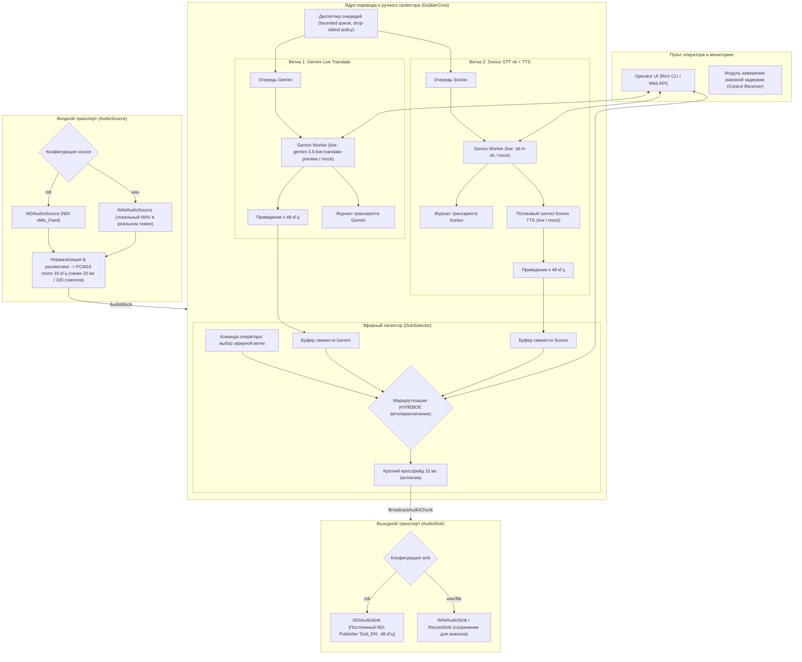

# Архитектурный дизайн: PharmaLive Dubber — Задача 1А (RU → EN)

**Проект:** PharmaLive Dubber  
**Этап:** Задача 1А (Первый пилот: один русский вход → две ветки Gemini/Soniox → ручной селектор → `Dub_EN`)  
**Дата:** 24 ноября 2026 г.  
**Статус:** Согласован / На утверждении  

---

## 1. Контекст и цели задачи 1А

### 1.1. Главная цель
На контрольном NDI-приёмнике оператор находит один постоянный источник `Dub_EN`, слышит синхронный английский перевод одного русского сигнала и может вручную переключать, какая из двух работающих веток (Gemini Live Translate или Soniox STT v6 + TTS) выдаётся в эфир.

### 1.2. Ключевое архитектурное требование (VPS-ready)
Входной приём аудио и выходная передача эфирного звука **строго отделены** от ядра перевода и селектора:
- **Ядро перевода и селектор** оперируют стандартизированными структурами данных (`AudioBlock` на входе 16 кГц, `BroadcastAudioChunk` на выходе 48 кГц), не зависят от сетевого транспорта и могут работать без изменений как на локальной машине с NDI, так и на удалённом VPS.
- **Входной транспорт** реализует интерфейс `AudioSource` (`NDIAudioSource`, `WAVAudioSource`, в перспективе — WebRTC/SRT для VPS).
- **Выходной транспорт** реализует интерфейс `AudioSink` (`NDIAudioSink`, `WAVAudioSink`, в перспективе — WebRTC/SRT для VPS).

---

## 2. Архитектура и сквозной пайплайн



---

## 3. Спецификация интерфейсов и структур данных

### 3.1. Структура входного блока (`AudioBlock`)
Каждый блок исходной русской речи снабжается метаданными синхронизации:
```python
@dataclass(frozen=True)
class AudioBlock:
    session_id: str          # Идентификатор сессии эфира
    block_index: int         # Монотонный порядковый номер блока (0, 1, 2...)
    sample_offset: int       # Смещение в сэмплах от начала сессии (шаг 320 при 16 кГц)
    source_time: float       # Время на шкале программы (секунды, монотонные часы)
    pcm_data: bytes          # 640 байт (20 мс PCM16 mono 16 кГц, little-endian)
```

### 3.2. Интерфейс `AudioSource`
```python
class AudioSource(ABC):
    @abstractmethod
    async def start(self) -> None:
        """Инициализация и запуск захвата."""
        ...

    @abstractmethod
    async def stop(self) -> None:
        """Остановка источника и освобождение ресурсов."""
        ...

    @abstractmethod
    async def read_block(self) -> AudioBlock:
        """Асинхронное чтение очередного 20 мс блока."""
        ...
```
- **`NDIAudioSource`**: Подключается к NDI через `ndi-python`, захватывает аудиокадры (Float32/Int16 48 кГц), ресемплирует с помощью `scipy.signal.resample_poly` в 16 кГц mono, формирует чанки по 320 сэмплов (20 мс) с отметками времени.
- **`WAVAudioSource`**: Читает моно/стерео WAV-файл любой частоты, ресемплирует в 16 кГц mono, выдаёт чанки по 20 мс строго с темпом реального времени (sleep с компенсацией дрифта).

### 3.3. Структура выходного эфирного блока (`BroadcastAudioChunk`)
```python
@dataclass(frozen=True)
class BroadcastAudioChunk:
    session_id: str          # Идентификатор сессии эфира
    language: str            # Целевой язык, например "en"
    source_branch: str       # Имя выдавшей ветки ("gemini" или "soniox")
    block_index: int         # Номер исходного блока или сквозной номер выхода
    source_time: float       # Время исходной речи на шкале программы
    sample_rate: int = 48000 # Стандарт вещания NDI (48 кГц)
    channels: int = 1        # Моно (или дублированное стерео)
    pcm_data: bytes = b""    # Сэмплы PCM16 (48 кГц, little-endian)
```

### 3.4. Интерфейс `AudioSink`
```python
class AudioSink(ABC):
    @abstractmethod
    async def start(self) -> None:
        """Создание постоянного выходного канала."""
        ...

    @abstractmethod
    async def stop(self) -> None:
        """Корректное закрытие канала вещания."""
        ...

    @abstractmethod
    async def write_chunk(self, chunk: BroadcastAudioChunk) -> None:
        """Отправка аудиоблока в канал вещания."""
        ...
```
- **`NDIAudioSink`**: Инициализирует постоянный NDI-публикатор `Dub_EN` через `ndi-python`. Источник создаётся один раз и существует непрерывно до завершения процесса. Если звук от селектора временно отсутствует, передаются нулевые сэмплы тишины для сохранения тактовой частоты NDI.
- **`WAVAudioSink`**: Записывает выходной эфирный поток в `.wav` для анализа и приёмки.

---

## 4. Спецификация компонентов ядра (`DubberCore`)

### 4.1. Диспетчеризация очередей
- Исходный `AudioBlock` от `AudioSource` помещается в две независимые очереди: `queue_gemini` и `queue_soniox`.
- Каждая очередь имеет ёмкость `maxsize=100` (2 секунды звука).
- Если воркер зависает или отстаёт, вызывается политика `drop_oldest`: старый блок удаляется, новый добавляется, в лог пишется предупреждение с указанием `block_index` и имени ветки.
- Захват звука и соседний воркер **никогда не блокируются**.

### 4.2. Воркер Gemini Live Translate (`GeminiWorker`)
- **Конфигурация:**
  - Модель: `gemini-3.5-live-translate-preview`.
  - SDK: `google-genai` v1beta async client (`client.aio.live.connect`).
  - Параметры: `response_modalities=["AUDIO"]`, `target_language_code="en"`, `echo_target_language=True`.
  - Входное аудио: PCM16 mono 16 кГц, отправка блоками по 100 мс (5 блоков по 20 мс) через `session.send_realtime_input`.
  - Выходное аудио: PCM16 mono 24 кГц.
  - DSP: Ресемплинг 24 кГц → 48 кГц для `BroadcastAudioChunk`.
- **Режимы (`provider_mode`):**
  - `live`: Реальное WebSocket-соединение с Gemini API. Читает `GEMINI_API_KEY` из окружения/`.env`.
  - `mock`: Синтетический генератор звука и текста с симуляцией задержки 1.2 с, переподключений и ошибок.
- **Журналирование:**
  - Все входящие распознанные и переведённые реплики сохраняются в `logs/transcript_gemini.jsonl`.
- **Отказоустойчивость:**
  - При ошибке API статус ветки меняется на `ERROR`, запускается фоновый реконнект. Автоматического переключения эфира не происходит.

### 4.3. Воркер Soniox STT v6 + TTS (`SonioxWorker`)
- **Конфигурация:**
  - Распознавание и перевод: Потоковый WebSocket Soniox `stt-rt-v6` с `translation: {"type": "one_way", "target_language": "en"}`.
  - Входное аудио: Потоковый PCM16 mono 16 кГц.
  - Синтез речи (TTS): Потоковый синтезатор Soniox TTS с готовым голосом.
  - Приём зафиксированных (`final`) токенов перевода и их немедленная отправка в TTS.
  - Выходное аудио от TTS: Приведение к 48 кГц для `BroadcastAudioChunk`.
- **Режимы (`provider_mode`):**
  - `live`: Реальные WebSocket-соединения Soniox STT + TTS. Читает `SONIOX_API_KEY`.
  - `mock`: Симулятор задержки распознавания текста (0.8 с) + синтеза речи (0.6 с) с возможностью инъекции обрыва связи.
- **Журналирование:**
  - Переведённые реплики фиксируются в `logs/transcript_soniox.jsonl` независимо от статуса TTS.
- **Отказоустойчивость:**
  - При отказе TTS текстовая фиксация сохраняется; статус ветки переходит в `TTS_ERROR`.

### 4.4. Эфирный селектор (`DubSelector`)
- **Постоянное состояние (`state.json`):**
  - Хранит текущий выбор: `active_branch: "gemini" | "soniox"`.
  - Восстанавливает последний выбор при перезапуске селектора.
- **Правило нулевого автоматического переключения:**
  - Сбой выбранной ветки **никогда** не приводит к автоматическому переключению на резерв.
  - При сбое активной ветки селектор выдаёт тишину и выставляет флаг `ALERT: ACTIVE_BRANCH_SILENT`.
- **Проверка свежести (Freshness Gate):**
  - При получении команды оператора на переключение:
    - Проверяется возраст последнего аудиоблока целевой ветки: $\Delta t = t_{current} - t_{last\_audio}$.
    - Если $\Delta t > 0.5$ с или ветка не в статусе `READY`, команда **отклоняется**: `REJECTED: BACKUP NOT FRESH`.
    - Для запоздало восстановившегося резерва требуется **новая** команда оператора.
- **Антиклик (Кроссфейд):**
  - При успешном переключении применяется линейный кроссфейд на протяжении 15 мс (720 сэмплов при 48 кГц) между хвостом старого потока и головой нового.

---

## 5. Пульт оператора и измерительный стенд

### 5.1. Интерфейс оператора
- **Консольный пульт (Rich TUI):**
  - Статус источника: частота кадров/блоков, число сброшенных блоков.
  - Таблица веток:
    | Ветка | Статус | Задержка | Свежесть звука | Последний текст |
    |---|---|---|---|---|
    | Gemini | READY / ERROR | 1.4 с | 40 мс назад | "Welcome to our conference..." |
    | Soniox | READY / ERROR | 1.1 с | 35 мс назад | "Welcome to our conference..." |
  - Активный эфир: `[ Dub_EN -> SONIOX ]`.
  - Горячие клавиши / команды:
    - `1` / `g` — переключить на Gemini
    - `2` / `s` — переключить на Soniox
    - `f` — имитировать сбой текущей ветки (в mock-режиме)
    - `r` — имитировать восстановление ветки
    - `q` — корректная остановка
- **REST / WebSocket API (FastAPI):**
  - Эндпоинты: `GET /status`, `POST /switch/{branch}`, `GET /events`.

### 5.2. Методика измерения сквозных задержек и переключения
- **Сквозная задержка (цель $\le 3$ с):**
  - Размеченная русская запись содержит метки времени начала контрольных фраз $T_{in}$.
  - На выходе `Dub_EN` детектор голосовой активности (VAD / Energy Threshold) фиксирует момент первого слышимого английского слова $T_{out}$.
  - Задержка $L = T_{out} - T_{in}$.
  - Расчёт статистики: $p50$, $p95$, $max$, процент превышений $> 3.0$ с, число пропусков.
- **Задержка переключения (цель $\le 0.5$ с для горячего резерва):**
  - Фиксация момента отправки команды оператора $T_{cmd}$.
  - Фиксация момента появления первого сэмпла новой ветки в NDI-выходе $T_{switched}$.
  - $\Delta T_{switch} = T_{switched} - T_{cmd}$.

---

## 6. План файлов проекта

```
d:\audio_translator\
├── pyproject.toml              # Проект uv с зависимостями
├── README.md                   # Инструкция запуска и проверки
├── .env.example                # Шаблон переменных окружения
├── dubber/
│   ├── __init__.py
│   ├── config.py               # Pydantic настройки (env + CLI)
│   ├── types.py                # AudioBlock, BroadcastAudioChunk, BranchStatus
│   ├── ingest/
│   │   ├── base.py             # AudioSource ABC
│   │   ├── ndi_source.py       # NDIAudioSource (ndi-python)
│   │   └── wav_source.py       # WAVAudioSource (real-time pace)
│   ├── workers/
│   │   ├── base.py             # BaseWorker ABC
│   │   ├── gemini_worker.py    # Gemini Live Translate (live + mock)
│   │   └── soniox_worker.py    # Soniox STT v6 + TTS (live + mock)
│   ├── selector/
│   │   ├── state.py            # Персистентное состояние селектора
│   │   └── selector.py         # DubSelector (ручной выбор, свежесть, кроссфейд)
│   ├── sink/
│   │   ├── base.py             # AudioSink ABC
│   │   ├── ndi_sink.py         # NDIAudioSink (NDI Dub_EN publisher)
│   │   └── wav_sink.py         # WAVAudioSink (запись для проверки)
│   ├── engine.py               # DubberEngine (координатор очередей и задач)
│   ├── operator/
│   │   ├── cli.py              # Консольный интерактивный пульт (Rich)
│   │   └── server.py           # Легковесный FastAPI/WebSocket API
│   ├── cli.py                  # CLI точка входа: uv run dubber run / test-run
│   └── measure/
│       ├── latency.py          # Анализатор задержки и VAD
│       └── report.py           # Генерация отчёта приёмки
└── tests/
    ├── test_audio_block.py
    ├── test_wav_ingest.py
    ├── test_selector_freshness.py
    ├── test_gemini_worker.py
    ├── test_soniox_worker.py
    └── test_end_to_end_mock.py
```

---

## 7. Критерии приемки задачи 1А

1. **Захват:** В режимах `ndi` и `wav` поток делится на одинаковые блоки по 20 мс с монотонными номерами и метками времени без взаимной блокировки ветвей.
2. **Изоляция веток:** Сбой, задержка или обрыв Gemini не влияет на поток Soniox, и наоборот.
3. **Ручной выбор:** Источник `Dub_EN` изменяется **только** по команде оператора. При сбое активной ветки вещание переходит в тишину без автопереключения.
4. **Контроль свежести:** Переключение на неактуальный (>0.5 с) или неготовый резерв блокируется.
5. **Сохранение состояния:** Выбор ветки переживает перезапуск селектора.
6. **Замеры задержек:**
   - Сквозная задержка от русской фразы до слышимого перевода $\le 3.0$ с.
   - Задержка переключения на готовый горячий резерв $\le 0.5$ с.
